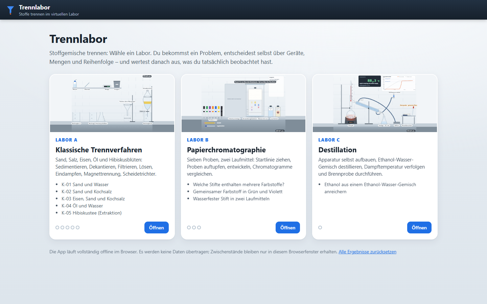

# SiVex – Simulationen und virtuelle Experimente

SiVex ist eine thematisch organisierte Sammlung interaktiver naturwissenschaftlicher Lernanwendungen für den schulischen Einsatz. Die Simulationen laufen eigenständig im Browser und sollen auch in mebis (ByCS) nutzbar sein.

## Anwendungen – Chemie

| Anwendung | Verzeichnis | Status |
| --- | --- | --- |
| **TitraLab 3 (Claude)** – Säure-Base-Titration | `apps/titration/` | **Ausgewählt**; läuft in mebis, auf dem iPad (Safari, iPadOS 26.6.2) sowie in Edge und Firefox (Windows 11) getestet. **[⬇ SCORM 1.2](https://github.com/sscheidl/sivex/raw/main/apps/titration/release/SiVex-Titration-Claude-v3-mebis-SCORM12.zip)** · [⬇ Web-ZIP](https://github.com/sscheidl/sivex/raw/main/apps/titration/release/SiVex-Titration-Claude-v3-web.zip). Import als entpackter Quellcode ausstehend |
| [Redoxlabor – Fehling- und Tollens-Probe](apps/redoxlabor/) | `apps/redoxlabor/` | **ready** – Redoxlabor 1.3.1 (Claude Code; überarbeitet nach Prüfung vom 22.10.2026, Zucker als Feststoffe, GHS-Kennzeichnung, Bedienfeld nach iPad-Test verschiebbar), Quellcode im Repo. In mebis auf dem iPad getestet und von der Lehrkraft freigegeben (23.10.2026); auf dem iPad (Safari, iPadOS 26.6.2) sowie in Edge und Firefox (Windows 11) funktionsfähig und lesbar; einzelne Grafikfehler werden getrennt behoben. **[⬇ SCORM 1.2](https://github.com/sscheidl/sivex/raw/main/apps/redoxlabor/release/redoxlabor-1.3.1-scorm12.zip)** · [⬇ Web-ZIP](https://github.com/sscheidl/sivex/raw/main/apps/redoxlabor/release/redoxlabor-1.3.1-web.zip) · [Testbericht](apps/redoxlabor/docs/TESTBERICHT.md) |
| [Trennlabor – Stofftrennung](apps/trennlabor/) | `apps/trennlabor/` | **prototype** – Trennlabor 1.0 (Claude Code): klassische Trennverfahren (K-01–K-05), Papierchromatographie, Destillation Ethanol/Wasser; Jgst. 8/9, Quellcode mit Tests. **[⬇ SCORM 1.2](https://github.com/sscheidl/sivex/raw/main/apps/trennlabor/release/trennlabor-1.0.0-scorm12.zip)** · [⬇ Web-ZIP](https://github.com/sscheidl/sivex/raw/main/apps/trennlabor/release/trennlabor-1.0.0-web.zip) · [Testbericht](apps/trennlabor/docs/TESTBERICHT.md) |
| [Trennverfahren – Stoffgemische trennen](apps/trennverfahren/) | `apps/trennverfahren/` | In Planung – Aufteilung des Trennlabors ([Begründung](docs/decisions/2026-10-23-trennlabor-aufteilung.md)) |
| [Papierchromatographie](apps/chromatographie/) | `apps/chromatographie/` | In Planung – Aufteilung des Trennlabors |
| [Destillation Ethanol/Wasser](apps/destillation/) | `apps/destillation/` | In Planung – Aufteilung des Trennlabors |
| Esterbildung und chemisches Gleichgewicht | `apps/ester-gleichgewicht/` | In Planung |

Es gibt **keine separate ältere Titrationsversion** im Zielbestand. Die zuvor dokumentierte Codex-Version TitraLab 2 ist verworfen und wurde nicht als Quellcode eingecheckt.

## Vorschau

| TitraLab 3 – Säure-Base-Titration | Redoxlabor – Fehling- und Tollens-Probe |
| --- | --- |
|  |  |
| **[⬇ SCORM 1.2](https://github.com/sscheidl/sivex/raw/main/apps/titration/release/SiVex-Titration-Claude-v3-mebis-SCORM12.zip)** · [⬇ Web-ZIP](https://github.com/sscheidl/sivex/raw/main/apps/titration/release/SiVex-Titration-Claude-v3-web.zip) | **[⬇ SCORM 1.2](https://github.com/sscheidl/sivex/raw/main/apps/redoxlabor/release/redoxlabor-1.3.1-scorm12.zip)** · [⬇ Web-ZIP](https://github.com/sscheidl/sivex/raw/main/apps/redoxlabor/release/redoxlabor-1.3.1-web.zip) |

| Trennlabor – Stofftrennung |
| --- |
|  |
| **[⬇ SCORM 1.2](https://github.com/sscheidl/sivex/raw/main/apps/trennlabor/release/trennlabor-1.0.0-scorm12.zip)** · [⬇ Web-ZIP](https://github.com/sscheidl/sivex/raw/main/apps/trennlabor/release/trennlabor-1.0.0-web.zip) |

## Aufbau

Die Verzeichnisse sind **nach Experiment**, nicht nach Fach oder Jahrgangsstufe sortiert. Fach und Jahrgangsstufen stehen in `sivex.json`; das ermöglicht eine spätere Zuordnung zu mehreren LehrplanPLUS-Lernbereichen. Weitere Fächer sind derzeit nicht geplant.

## Veröffentlichungswege

1. **Webserver:** Statische Dateien über HTTPS bereitstellen.
2. **mebis:** SCORM-1.2-ZIP pro Simulation als Aktivität „Lernpaket (SCORM)“ starten.

## Qualitätsgrundsätze

- Fachliche Richtigkeit und didaktische Angemessenheit
- Handlungsgekoppelte Reaktionen und Animationen
- Touchbedienbarkeit und verständliche Benutzerführung
- Keine personenbezogenen Schülerdaten an Drittanbieter
- Getestete Web- und mebis-Ausführung

Siehe [mebis-Konzept](docs/MEBIS.md), [Architektur](docs/ARCHITECTURE.md) und [Qualitätsregeln](docs/QUALITY.md).

## Code-Stand

Im Repository liegen derzeit Projektstruktur, Dokumentation und Manifeste. Die SCORM-1.2-Pakete liegen jeweils im Ordner `release/` der Anwendung: TitraLab 3 unter [`apps/titration/release/SiVex-Titration-Claude-v3-mebis-SCORM12.zip`](apps/titration/release/SiVex-Titration-Claude-v3-mebis-SCORM12.zip), das Redoxlabor unter [`apps/redoxlabor/release/`](apps/redoxlabor/release/). Das Trennlabor liegt unter [`apps/trennlabor/release/`](apps/trennlabor/release/). Redoxlabor und Trennlabor sind zusätzlich als Quellcode mit Tests eingecheckt; bei TitraLab 3 steht der Import als entpackter Quellcode noch aus. Die Herkunft aus dem SCORM-Release ist beim Import zu kennzeichnen.

## Lizenz

Die Datei `LICENSE` enthält die MIT-Lizenz.
