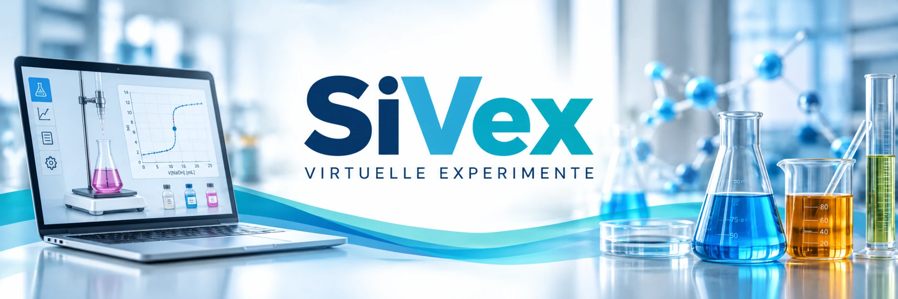
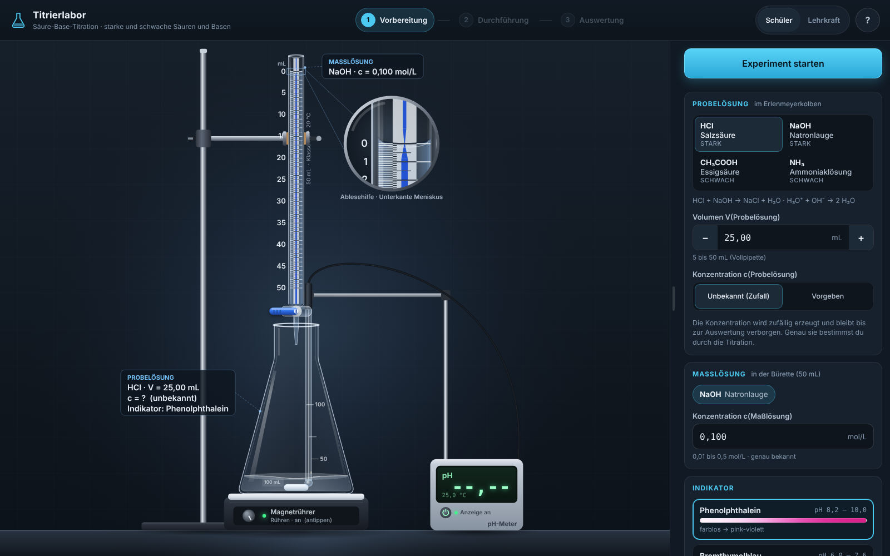
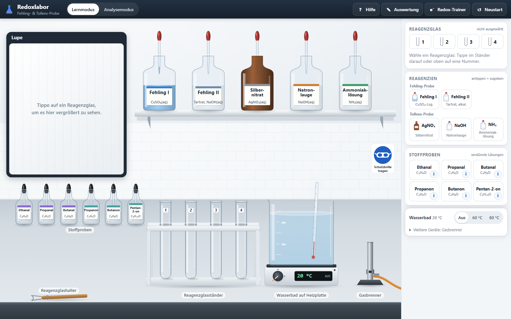
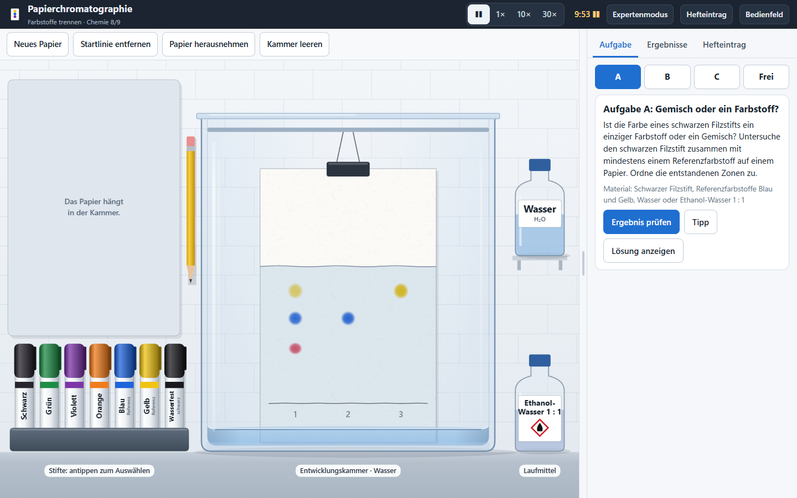
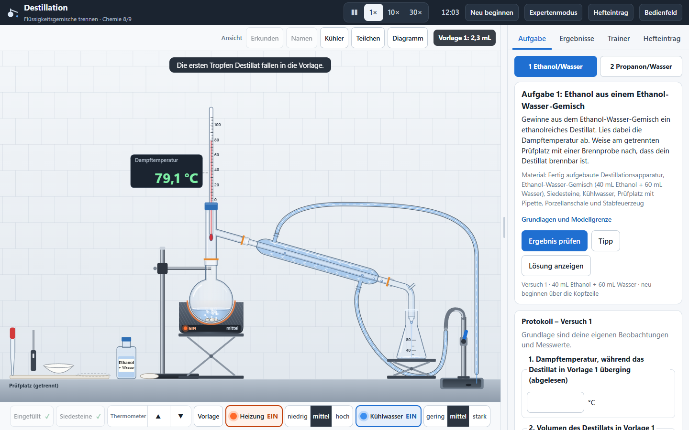
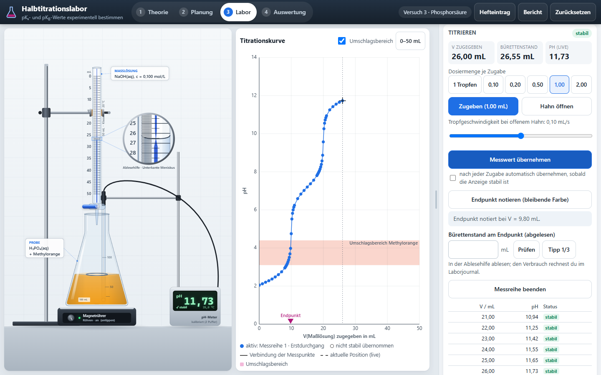
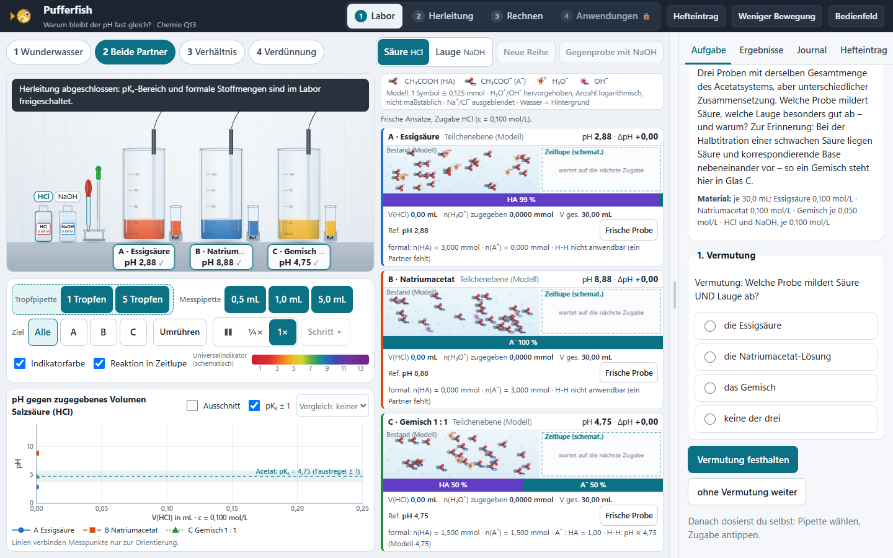
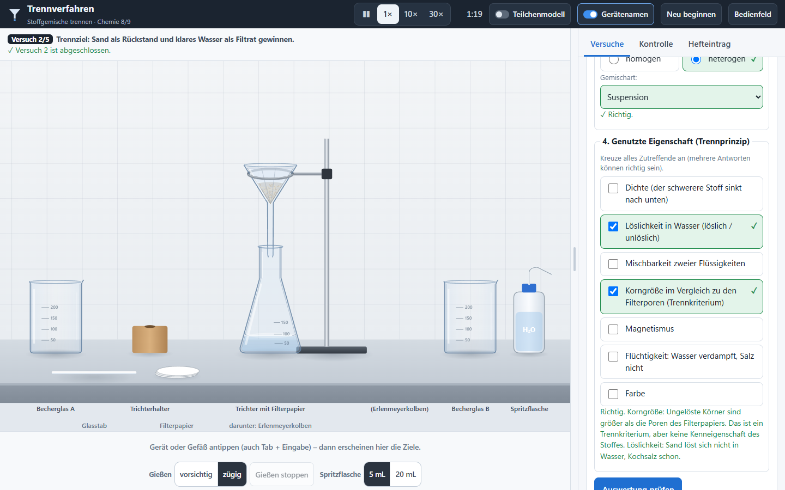

# SiVex – Simulationen und virtuelle Experimente

SiVex ist eine Sammlung interaktiver naturwissenschaftlicher Lernanwendungen für den Unterricht. Jede Simulation läuft eigenständig im Browser, offline und ohne Konto – auf dem Webserver oder als Lernpaket in mebis (ByCS).

## Anwendungen – Chemie

| Anwendung | Stand | Download |
| --- | --- | --- |
| [**TitraLab 3** – Säure-Base-Titration](apps/titration/) | in Verwendung (v3) · in mebis und auf dem iPad getestet | **[⬇ SCORM 1.2](https://github.com/sscheidl/sivex/raw/main/apps/titration/release/SiVex-Titration-Claude-v3-mebis-SCORM12.zip)** · [⬇ Web-ZIP](https://github.com/sscheidl/sivex/raw/main/apps/titration/release/SiVex-Titration-Claude-v3-web.zip) |
| [**Redoxlabor** – Fehling- und Tollens-Probe](apps/redoxlabor/) | **ready** 1.3.1 · in mebis auf dem iPad freigegeben | **[⬇ SCORM 1.2](https://github.com/sscheidl/sivex/raw/main/apps/redoxlabor/release/redoxlabor-1.3.1-scorm12.zip)** · [⬇ Web-ZIP](https://github.com/sscheidl/sivex/raw/main/apps/redoxlabor/release/redoxlabor-1.3.1-web.zip) · [Testbericht](apps/redoxlabor/docs/TESTBERICHT.md) |
| [**Papierchromatographie**](apps/chromatographie/) | prototype 0.2.0 · Jgst. 8/9 | **[⬇ SCORM 1.2](https://github.com/sscheidl/sivex/raw/main/apps/chromatographie/release/chromatographie-0.2.0-scorm12.zip)** · [⬇ Web-ZIP](https://github.com/sscheidl/sivex/raw/main/apps/chromatographie/release/chromatographie-0.2.0-web.zip) · [Testbericht](apps/chromatographie/docs/TESTBERICHT.md) |
| [**Destillation**](apps/destillation/) | prototype 0.3.0 · Jgst. 8/9 | **[⬇ SCORM 1.2](https://github.com/sscheidl/sivex/raw/main/apps/destillation/release/destillation-0.3.0-scorm12.zip)** · [⬇ Web-ZIP](https://github.com/sscheidl/sivex/raw/main/apps/destillation/release/destillation-0.3.0-web.zip) · [Testbericht](apps/destillation/docs/TESTBERICHT.md) |
| [**Trennverfahren** – Stoffgemische trennen](apps/trennverfahren/) | prototype 0.1.0 · Jgst. 8/9 | **[⬇ SCORM 1.2](https://github.com/sscheidl/sivex/raw/main/apps/trennverfahren/release/trennverfahren-0.1.0-scorm12.zip)** · [⬇ Web-ZIP](https://github.com/sscheidl/sivex/raw/main/apps/trennverfahren/release/trennverfahren-0.1.0-web.zip) · [Testbericht](apps/trennverfahren/docs/TESTBERICHT.md) |
| [**Halbtitrationslabor**](apps/halbtitration/) – pKₛ- und pK_B-Werte | prototype 0.1.0 · Q13 eA | **[⬇ SCORM 1.2](https://github.com/sscheidl/sivex/raw/main/apps/halbtitration/release/halbtitration-0.1.0-scorm12.zip)** · [⬇ Web-ZIP](https://github.com/sscheidl/sivex/raw/main/apps/halbtitration/release/halbtitration-0.1.0-web.zip) · [Testbericht](apps/halbtitration/docs/TESTBERICHT.md) |
| [**Pufferfish**](apps/pufferfish/) – Warum bleibt der pH fast gleich? (Puffer) | prototype 0.1.0 · Q13 eA | **[⬇ SCORM 1.2](https://github.com/sscheidl/sivex/raw/main/apps/pufferfish/release/pufferfish-0.1.0-scorm12.zip)** · [⬇ Web-ZIP](https://github.com/sscheidl/sivex/raw/main/apps/pufferfish/release/pufferfish-0.1.0-web.zip) · [Testbericht](apps/pufferfish/docs/TESTBERICHT.md) |

In Planung: [Esterbildung und chemisches Gleichgewicht](apps/ester-gleichgewicht/).

## Vorschau

| TitraLab 3 | Redoxlabor |
| --- | --- |
|  |  |
| **Papierchromatographie** | **Destillation** |
|  |  |
| **Halbtitrationslabor** | **Pufferfish** |
|  |  |
| **Trennverfahren** | |
|  | |

## Einsatz im Unterricht

1. **mebis:** SCORM-1.2-ZIP als Aktivität „Lernpaket (SCORM)“ hochladen; Darstellung „Neues Fenster“ empfohlen ([mebis-Hinweise](docs/MEBIS.md)).
2. **Webserver oder lokal:** Web-ZIP entpacken und `index.html` öffnen – auch ohne Internetverbindung.

Es werden keine Noten, Antworten oder personenbezogenen Daten übertragen.

## Aufbau des Repositorys

Je Experiment ein Verzeichnis unter `apps/` mit Quellcode, Tests, Dokumentation und dem aktuellen Release im Ordner `release/` (Prüfsummen in `SHA256SUMS.txt`). Auf `main` liegt nur der jeweils aktuelle Stand; frühere Versionen sind über die Git-Historie und Tags erreichbar. Gemeinsame Bausteine der Trenn-Apps stehen in [`shared/labkit/`](shared/labkit/).

Weitere Dokumentation: [Architektur](docs/ARCHITECTURE.md) · [Qualitätsregeln](docs/QUALITY.md) · [mebis-Konzept](docs/MEBIS.md)

## Lizenz

MIT-Lizenz, siehe `LICENSE`.
