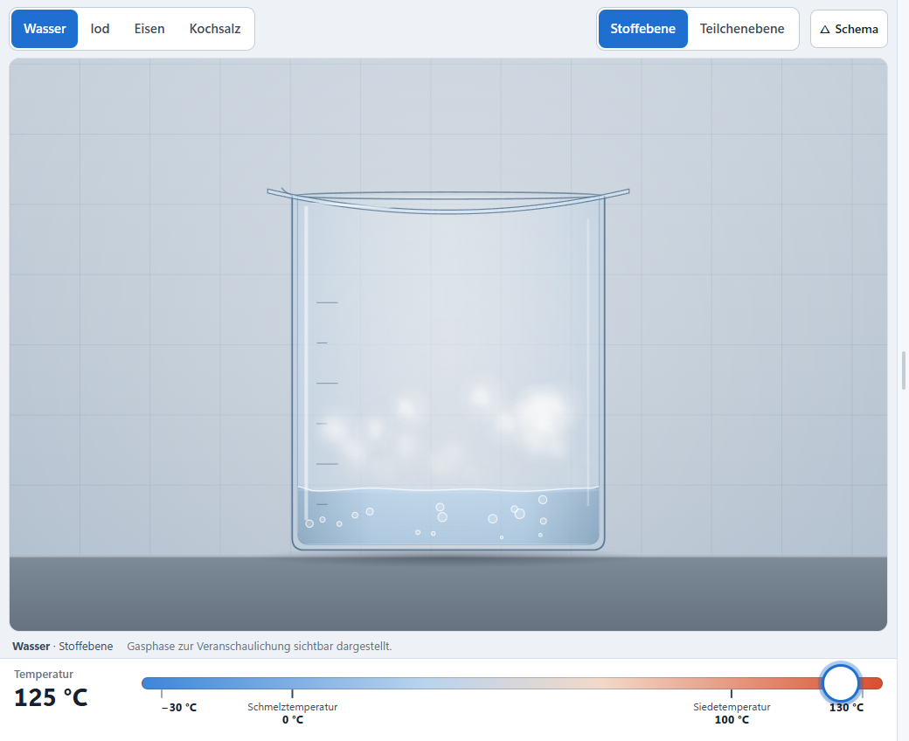

# Aggregatzustände und Teilchenmodell

**prototype 0.2.0** · Chemie Jgst. 8 (NTG) / 9 (SG) · Labkit 0.1.1 · [Testbericht](docs/TESTBERICHT.md) · [Chemie und Vereinfachungen](docs/CHEMIE.md) · [Bedienung](docs/BEDIENUNG.md)

Wasser, Iod, Eisen und Kochsalz bei frei wählbarer Temperatur – fest, flüssig und gasförmig, auf der **Stoffebene** (Becherglas mit Uhrglas bzw. Tiegel im Ofen – jeweils geschlossen) und auf der **Teilchenebene**. Ein zuschaltbares Schema neben dem Bild zeigt, welcher Übergang gerade abläuft. Schmelz- und Siedetemperatur als Kenneigenschaften, die sechs Phasenübergänge, Sublimation und Resublimation von Iod an einer kalten Oberfläche.



## Lernziele

1. Fest, flüssig und gasförmig mit ihren typischen Eigenschaften gelten auch für Stoffe wie Eisen und Kochsalz.
2. Schmelz- und Siedetemperatur sind Kenneigenschaften eines Reinstoffs (bei gegebenem Druck).
3. Die sechs Übergänge heißen Schmelzen, Erstarren, Verdampfen, Kondensieren, Sublimieren, Resublimieren.
4. Beobachtung auf der Stoffebene, Erklärung im Teilchenmodell: Anordnung, Abstände, Bewegung, Zusammenhalt.

## Aufbau

| Datei | Inhalt |
| --- | --- |
| `js/substances.js` | **ein** Konfigurationsobjekt für alle vier Stoffe (Temperaturen, Reglerbereich, Teilchensymbole, Aussehen) |
| `js/model.js` | Zustandsmodell ohne DOM: Temperatur direkt, Darstellung verzögert, weicher Zustandswechsel über eine Größe p (0 fest, 1 flüssig, 2 gasförmig), Ioddampf und kalte Oberfläche |
| `js/particles.js` | **eine** Teilchen-Engine ohne DOM für alle Stoffe (48 Teilchen, feste Rechenschritte, reproduzierbar) |
| `js/render-matter.js` | Stoffebene, Canvas 2D: Becherglas nach TitraLab 3 mit Uhrglas als Deckel, Ofen im Schnitt mit glühenden Heizstäben und Keramiktiegel, Eis, Iodkristalle, Eisenquader, Salzwürfel auf Salzkruste, Schmelzen, Wellen, Siedeblasen, Kondenströpfchen, Gas im geschlossenen Gefäß |
| `js/render-particles.js` | Teilchenebene, Canvas 2D: Symbole (Dreieck, Rechteck, Kugeln) |
| `js/tasks.js` | Lernweg in drei Schritten, Prüfung je Feld, drei Hilfestufen, Lösungen, Hefteintrag (ohne DOM) |
| `js/ui.js`, `js/app.js` | Oberfläche: Stoff- und Ebenenwahl, Regler (Skala bei Eisen und Kochsalz gestaucht), Schema der Phasenübergänge, Legende, Bedienfeld, Trennlinie (Labkit), Sitzungsspeicher |

Fachzustand, Darstellung, Oberfläche und Aufgaben sind getrennt. Beide Ansichten lesen denselben Modellzustand. Aus dem Labkit werden `core.js`, `splitter.js`, `scorm.js` und `labkit.css` unverändert genutzt.

## Entwickeln und prüfen

```bash
npm install          # Playwright für die Browsertests (PLAYWRIGHT_SKIP_BROWSER_DOWNLOAD=1, Edge wird genutzt)
npm start            # http://localhost:8080/ (Quellstand; labkit/ wird auf shared/labkit abgebildet)
npm test             # Unit-Tests: Modell, Teilchen-Engine, Aufgaben
npm run package      # Build (dist/) und Pakete (release/)
npm run test:e2e     # Browsertests E01–E15 (Edge), Bilder nach docs/screenshots/
npm run test:scorm   # Pakete frisch entpackt: SCORM im Mock-LMS, Web-ZIP per HTTP und file://
```

## Pakete

- [`release/aggregatzustaende-0.2.0-scorm12.zip`](release/aggregatzustaende-0.2.0-scorm12.zip) – SCORM 1.2 für mebis (Darstellung „Neues Fenster“ empfohlen)
- [`release/aggregatzustaende-0.2.0-web.zip`](release/aggregatzustaende-0.2.0-web.zip) – Webserver oder lokal (`index.html` öffnen)
- Prüfsummen: [`release/SHA256SUMS.txt`](release/SHA256SUMS.txt)

Kein Backend, keine externen Ressourcen, keine Übertragung von Antworten, Noten oder personenbezogenen Daten.

## Status

`prototype` bis zur fachlichen Freigabe durch die Lehrkraft und zum Test auf dem iPad und in mebis (siehe Testbericht).
