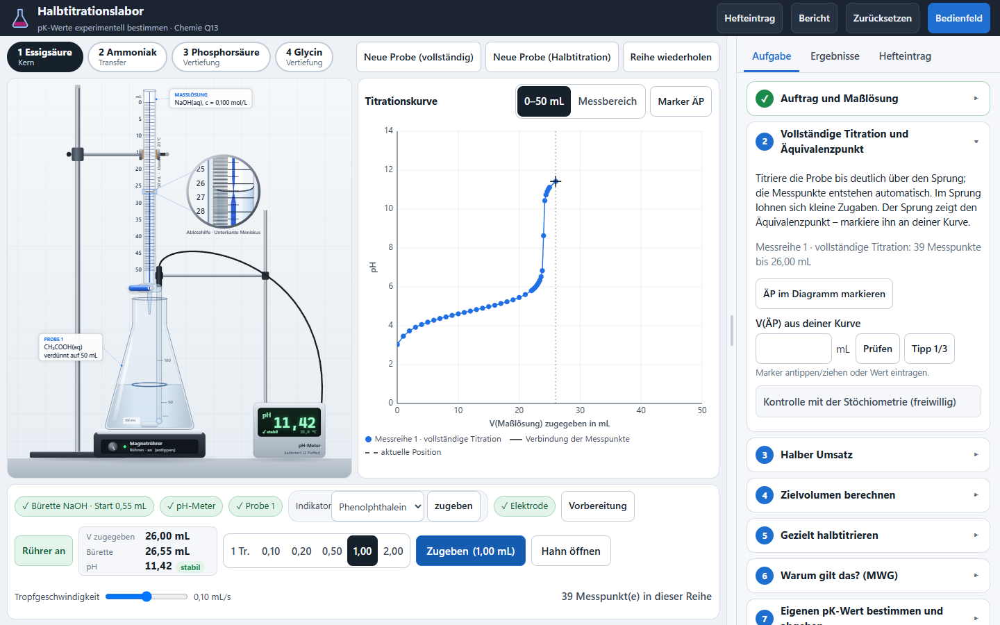

# Halbtitrationslabor – pKₛ- und pK_B-Werte experimentell bestimmen

**Status: prototype 0.2.2** · Chemie Q13 (eA), LehrplanPLUS Gymnasium Bayern, Lernbereich 3 · statische Browseranwendung ohne Backend, Konto oder Netzzugriff · SiVex-Labkit 0.1.1



Die Lernenden kennen Titration, pKₛ/pK_B und die zugehörigen Rechnungen. Neu ist die **experimentelle Bestimmung eines pK-Werts durch Halbtitration**. Die App startet deshalb direkt im Labor mit einem kurzen Auftrag:

**vollständig titrieren → ÄP am Sprung der eigenen Kurve → halben Umsatz untersuchen → Zielvolumen berechnen → frische Probe gezielt halbtitrieren → am MWG begründen → eigenen pK abgeben → mit der Literatur vergleichen und sichern**

| Versuch | Rolle | Probe + Maßlösung | Schwerpunkt |
| --- | --- | --- | --- |
| 1 | **Kern** | Essigsäure + NaOH | Halbtitration erarbeiten: c(A⁻) ≈ c(HA) → Kₛ ≈ c(H₃O⁺) → pKₛ ≈ pH |
| 2 | **Transfer** | Ammoniak + HCl | fallende Kurve, pOH ≈ pK_B, pK_B ≈ 14,00 − pH, pH ≈ pKₛ(NH₄⁺) |
| 3 | Vertiefung | Phosphorsäure + NaOH | zwei Stufen, V(HÄP,2) = [V(ÄP,1) + V(ÄP,2)]/2, Näherungsgrenze am HÄP 1 |
| 4 | Vertiefung | Glycinhydrochlorid + NaOH | zwei pKₛ-Werte, Kation → Zwitterion → Anion, abgeleitetes V(ÄP,2) |

Alle vier Versuche sind direkt anwählbar und vollständig bedienbar. Kurve, ÄP-Marker und Messwerte entstehen nur aus eigenen Handlungen. Literaturwerte und Modellreferenz erscheinen erst nach der Abgabe eines eigenen, nachweisbar gemessenen Ergebnisses oder nach einer bewusst angeforderten Musterlösung. Pufferwirkung und -herstellung behandelt die App „Pufferfish“.

## Start

- **Ohne Installation:** Web-ZIP aus `release/` entpacken und `halbtitration/index.html` öffnen. Das funktioniert auch per `file://` und offline.
- **mebis:** `release/halbtitration-0.2.2-scorm12.zip` als „Lernpaket (SCORM)“ hochladen, Darstellung „Neues Fenster“ (siehe [`docs/MEBIS.md`](../../docs/MEBIS.md)). Es werden keine Noten, Fortschritte oder Personendaten übertragen.
- **Entwicklung:** `npm start`, dann http://localhost:8080/. Der Server bildet `/labkit/` auf `shared/labkit/` ab.

```bash
PLAYWRIGHT_SKIP_BROWSER_DOWNLOAD=1 npm install   # nur für Browserprüfungen: Playwright 1.56.1, nutzt das installierte Edge
npm test               # Modell-, Auswertungs- und Speichertests (node --test)
npm run build          # dist/halbtitration/ inkl. labkit/, Prüfung auf externe Ressourcen und fehlende Dateien
npm run package        # release/: Web-ZIP, SCORM-1.2-ZIP, SHA256SUMS.txt (reproduzierbare Zeitstempel)
npm run test:e2e       # Browserprüfung E1–E9, Screenshots in docs/screenshots/ (ONLY=E1,E5 für Auswahl)
npm run test:packages  # beide ZIPs frisch entpacken, über HTTP und file:// starten, SCORM mit Test-LMS
```

## Aufbau

```text
index.html, css/app.css      App-Hülle auf Basis von labkit/css/labkit.css
js/model/       chemistry.js (Gleichgewichtssolver), indicators.js, evaluation.js (Rechen- und Nachweisprüfung), format.js
js/experiment/  lab.js (Bürette, Tropfen, Mischung, Elektrode – ohne DOM)
js/view/        geometry.js, lab-renderer.js (aus TitraLab 3), chart.js (Titrationskurve)
js/ui/          content.js (Aufträge, Fragen, MWG-Trainer, Hilfen, Hefteintrag), store.js (Speicherung v2 mit Migration),
                tasks.js (Aufgabe, Prüfstatus, Abgabe, Ergebnisse, Bericht), app.js (Bühne, Dosierleiste, Kurve, Ereignisse)
tests/unit/     Modelltests mit unabhängigen Referenzen, Regressionstests zum Review, Speichermigration
tests/e2e/      Browserabläufe (run.mjs, flow.mjs), Paketprüfung (packages.mjs)
docs/           CHEMIE.md, BEDIENUNG.md, TESTBERICHT.md, UEBERNAHME.md, screenshots/
```

## Herkunft

Laboraufbau, Tropfen, Meniskus, Ablese-Lupe und Schlieren stammen aus **TitraLab 3** (`apps/titration/release/SiVex-Titration-Claude-v3-web.zip`). Die App-Hülle stammt aus dem **SiVex-Labkit**, Build- und Serverskripte stammen aus Pufferfish. Einzelheiten stehen in [`docs/UEBERNAHME.md`](docs/UEBERNAHME.md). Einen Service Worker gibt es nicht, daher auch keine Cache-Kollision mit TitraLab 3.

## Bekannte Grenzen

- Ideales Konzentrationsmodell (Aktivitäten = Konzentrationen) mit thermodynamischen Konstanten (Martell & Smith, 25 °C, I = 0); siehe [`docs/CHEMIE.md`](docs/CHEMIE.md).
- Kein Zufallsrauschen und kein Fehlermodus; Abweichungen entstehen nur durch eigene Handlungen. Eine Ableseübung an der Bürette gibt es nicht; der Stand wird digital übernommen, die Lupe bleibt sichtbar.
- Bei 1024 × 768 sind Apparatur und Kurve kleiner; das Bedienfeld lässt sich einklappen.
- Geprüft mit Edge (Chromium) unter Windows 11; Tablet-Größen nur emuliert. **iPad-Safari und mebis sind nicht geprüft** (siehe [`docs/TESTBERICHT.md`](docs/TESTBERICHT.md)).
