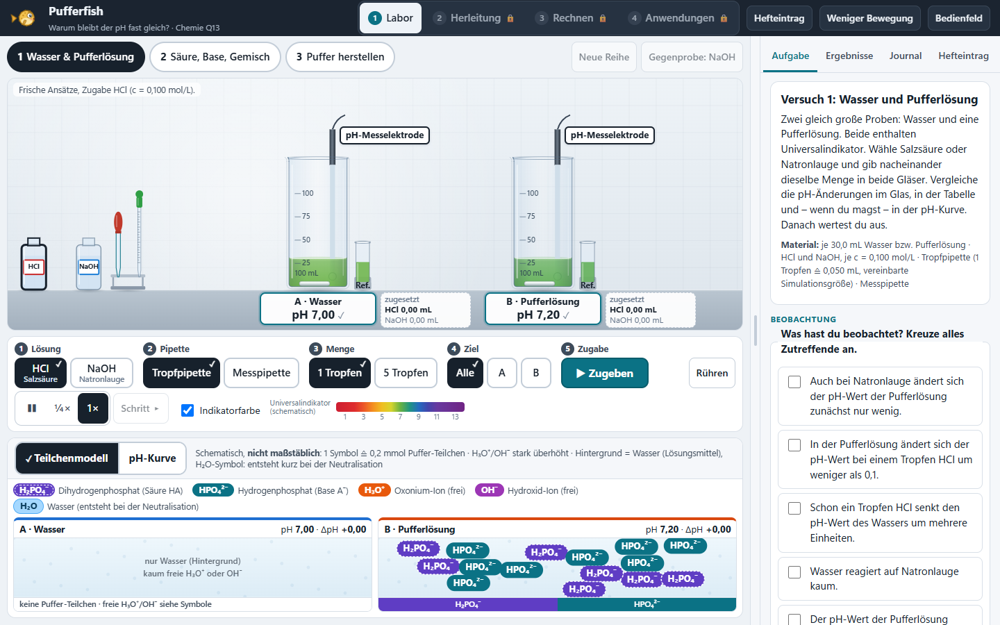

# Pufferfish – Warum bleibt der pH fast gleich?

SiVex-Lernsimulation für **Chemie Q13 (erhöhtes Anforderungsniveau)**: Pufferwirkung auf Stoff- und Teilchenebene, Herleitung und Anwendung der Henderson-Hasselbalch-Gleichung, Pufferbereich, begrenzte Pufferkapazität und – neu – einen **Puffer gezielt berechnen, herstellen und messen**. **Status: prototype 0.2.1** (Labkit 0.1.1). Kein Unterrichtseinsatz freigegeben: echtes iPad, mebis-Import und fachlich-didaktische Freigabe stehen aus ([Testbericht](docs/TESTBERICHT.md)).



## Lernweg

**Pufferwirkung experimentell untersuchen → Funktionsweise des korrespondierenden Säure-Base-Paars erklären → Henderson-Hasselbalch herleiten → passenden Puffer berechnen, herstellen und überprüfen.**

- **Pipetten-/Tropfversuch mit transparenten Bechergläsern** – keine Büretten-Titration. Tropfpipette (1 oder 5 Tropfen à 0,050 mL) und Messpipette (0,5/1,0/5,0 mL; in Versuch 3 bis 10 mL). Im Vergleichsmodus erhält jedes Glas nacheinander dieselbe Zugabe.
- **Genau drei Versuche:**
  1. **Wasser und Pufferlösung** – HCl oder NaOH wählen (Flasche im Laborbild antippen oder Schalter in der Dosierleiste), dosieren, vergleichen, auswerten; keine Vermutung nötig. Neben jedem Glas steht die **zugesetzte Gesamtmenge** HCl bzw. NaOH in mL – so wird sichtbar, wie viel mehr Säure oder Lauge die Pufferlösung für dieselbe pH-Änderung braucht.
  2. **Säure, Base und Gemisch** – Essigsäure, Natriumacetat und 1 : 1-Gemisch; jede Probe setzt Säure bzw. Lauge um, das Gemisch beides ohne große pH-Änderung.
  3. **Puffer gezielt herstellen** (ohne Voraussetzung, auch in einer Einzelstunde) – aus einem Ziel-pH (z. B. 5,05 · 6,90 · 9,55) das geeignete System wählen (**Acetat** pKₛ 4,75 · **Phosphat** 7,20 · **Ammonium/Ammoniak** 9,25), mit Henderson-Hasselbalch Verhältnis und Volumina **selbst rechnen**, die beiden Stammlösungen (je 0,100 mol/L, zusammen 30,0 mL) dosieren und den erreichten pH-Wert mit der **pH-Messelektrode** überprüfen. Ein Fehler im Verhältnis führt zu einem abweichenden Messwert; die Auswertung nennt die Ursache.
- **Stoffebene im Mittelpunkt:** Das Laborbild ist groß (Becherglas bei 1440×900 +42 % gegenüber 0.1.0), die Teilchen- bzw. Verhältnisdarstellung liegt darunter. Ein Umschalter *Teilchenmodell | pH-Kurve* (Versuch 3: *Mischungsverhältnis | pH-Kurve*) ersetzt die Zusatzansicht am selben Platz; die pH-Kurve ist beim Start verborgen und verliert beim Umschalten keine Messpunkte.
- **Teilchenmodell (0.2.1):** Essigsäure und Acetat als **HAc/Ac⁻**. Reagiert eine Zugabe mit dem Puffer, wandert H₃O⁺ bzw. OH⁻ zum Partner und es entsteht kurz **H₂O**; in Wasser (oder nach Erschöpfung) häufen sich freie H₃O⁺/OH⁻ an. Flaschen und Pipetten lassen sich direkt im Laborbild antippen; **Rühren** schaltet Rührfische ein.
- **Synchronisiert:** Stoffansicht (Universalindikator, Schlieren, Meniskus, Füllstand), schematisches Teilchenmodell (Versuche 1, 2) bzw. Mischungsverhältnis aus den tatsächlich zugegebenen Stoffmengen (Versuch 3) und die pH-Kurve lesen denselben Modellzustand.
- **Herleitung** in sieben Schritten mit Tipps (vor der Herstellung), **sechs Rechenaufgaben** mit getrennter Fehlerdiagnose, **vier Anwendungen** (Blut, Gewässer, biochemisches Labor, Messtechnik), Journal mit Druck/Export (Leitfragen unbewertet), Hefteintrag.
- Originales, code-natives **Pufferfisch-Logo** (SVG/CSS), das sich beim Start und auf Antippen aufpumpt.

**Layout geprüft:** Verglichen wurden (a) Laborbild links, Zusatzansicht rechts, (b) Laborbild und Dosierleiste oben, Zusatzansicht darunter (gewählt) und (c) Zusatzansicht als Überlagerung. (a) verkleinert das Laborbild bei gleicher Bildschirmbreite, (c) verdeckt die Stoffebene; (b) erlaubt den größten Maßstab, hält die Gläser gleichmäßig verteilt und zeigt keine konkurrierenden Zusatzpanels.

## Starten

- **Web:** `release/pufferfish-0.2.1-web.zip` entpacken und `pufferfish/index.html` öffnen (auch offline, auch per `file://`).
- **mebis:** `release/pufferfish-0.2.1-scorm12.zip` als „Lernpaket (SCORM)“ hochladen, Darstellung „Neues Fenster“ ([mebis-Hinweise](../../docs/MEBIS.md)). Es werden keine Noten, Antworten oder personenbezogenen Daten übertragen.
- **Entwicklung:** `npm start` (Server auf http://localhost:8080, Labkit wird aus `shared/labkit` eingebunden).
- **Speicherstand:** `sivex.pufferfish.v2`; der Stand von 0.1.0 wird nicht gelesen (Details in den [Bedienhinweisen](docs/BEDIENUNG.md)).

## Entwicklung und Prüfung

```bash
npm install          # nur Playwright (Edge oder Chromium wird genutzt: PLAYWRIGHT_SKIP_BROWSER_DOWNLOAD=1)
npm test             # Unit-Tests: Modell gegen unabhängige Referenzen, Zustandsablauf, Bewertung, Mischung
npm run package      # Build + Web-ZIP + SCORM-ZIP + SHA256SUMS.txt in release/
npm run test:e2e     # Browserprüfung (P01–P16) gegen dist/pufferfish
npm run test:scorm   # Pakete frisch entpacken und über HTTP/file:// starten, Mock-LMS
```

Prüfsummen: [`release/SHA256SUMS.txt`](release/SHA256SUMS.txt)

## Dokumentation

- [Chemisches Modell, Parameter, Quellen, Grenzen (inkl. NH₄⁺/NH₃)](docs/CHEMIE.md)
- [Bedienhinweise](docs/BEDIENUNG.md)
- [Testbericht mit P01–P16-Matrix](docs/TESTBERICHT.md)
- [Herkunft übernommener Teile](docs/UEBERNAHME.md)
- [Änderungsprotokoll](CHANGELOG.md)

## Dateien

| Datei | Inhalt |
| --- | --- |
| `js/chem.js` | Ladungsbilanz-Solver (Wasser, Acetat, Phosphat, Ammonium), Stammlösungen, Systeme und Herstellungsplan, formale Bilanz, H-H, Indikatorfarben (ohne DOM) |
| `js/geometry.js` | Weltkoordinaten der Bühne, Bechergläser, Flaschenplätze, Füllhöhe aus Volumen (ohne DOM) |
| `js/engine.js` | zentraler Zustand: Proben, Messreihen, Dosierwarteschlange, Tropfen/Strahl, Mischphase, Versuch 3 (Becherglas, Messung, Messprotokoll), Speichern (ohne DOM) |
| `js/learn.js` | Protokolle mit Leitfragen, Herleitung, Aufgaben mit Fehlerdiagnose, Herstellungsrechnung und Auswertung, gemischte Antwortreihenfolge, Anwendungen, Hefteintrag (ohne DOM) |
| `js/render-lab.js` | Laborbühne (Canvas) |
| `js/render-particles.js` | schematisches Teilchenmodell (Canvas) |
| `js/render-mix.js` | Mischungsverhältnis-Diagramm für Versuch 3 (HTML/CSS) |
| `js/chart.js` | pH-Kurve (Canvas; Versuch 3: Messpunkte gegen lg-Verhältnis) |
| `js/ui.js`, `js/app.js` | Oberfläche, Seiten, Journal, Zeitschleife |
