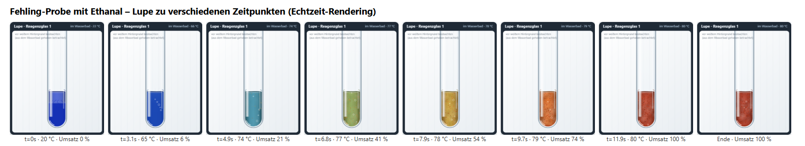
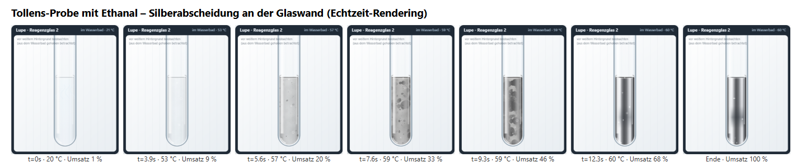

# Redoxlabor: Fehling- und Tollens-Probe

**Status: prototype** (fachlich und im Desktop-Browser geprüft, nach der [Prüfung vom 22.10.2026](docs/REVIEW-2026-10-22.md) überarbeitet – siehe [Umsetzung](docs/REVIEW-2026-10-22-UMSETZUNG.md); Test auf echten Schul-iPads und in mebis steht noch aus – siehe [Testbericht](docs/TESTBERICHT.md))

Virtuelles Chemielabor für die Jahrgangsstufe 10 (NTG). Die Lernenden setzen Fehling- und Tollens-Reagenz selbst an, geben Stoffproben (drei Aldehyde, drei Ketone) zu, erwärmen im Wasserbad, beobachten die Reaktion in einer Lupe, protokollieren und erarbeiten anschließend die Redoxgleichungen.


## Download

**[⬇ SCORM-1.2-Paket für mebis (redoxlabor-1.1.0-scorm12.zip)](https://github.com/sscheidl/sivex/raw/main/apps/redoxlabor/release/redoxlabor-1.1.0-scorm12.zip)** · [⬇ Web-Version (redoxlabor-1.1.0-web.zip)](https://github.com/sscheidl/sivex/raw/main/apps/redoxlabor/release/redoxlabor-1.1.0-web.zip)

In mebis: Kurs → „Aktivität oder Material anlegen“ → „Lernpaket (SCORM)“ → ZIP hochladen → Darstellung „Neues Fenster“.

| Fehling-Probe mit Ethanal | Tollens-Probe mit Ethanal |
| --- | --- |
|  |  |

## Starten

Die Anwendung ist vollständig statisch (HTML, CSS, JavaScript) und braucht weder Server-Logik noch Internet.

| Weg | Vorgehen |
| --- | --- |
| Direkt | `index.html` im Browser öffnen (funktioniert auch per `file://`). |
| Lokaler Testserver | `npm start` → <http://localhost:8080/> (Node.js ≥ 18, keine Abhängigkeiten nötig) |
| Webserver | `npm run build` und den Ordner `dist/redoxlabor/` per HTTPS auf einen beliebigen Webserver hochladen. Alle Pfade sind relativ. |

Empfohlene Browser: aktuelle Versionen von Safari (iPadOS), Chrome, Edge, Firefox.

## Release-Pakete

**Aktuell: 1.1.0** (überarbeitet nach der [Prüfung vom 22.10.2026](docs/REVIEW-2026-10-22-UMSETZUNG.md))

| Paket | Verwendung |
| --- | --- |
| [`release/redoxlabor-1.1.0-scorm12.zip`](release/redoxlabor-1.1.0-scorm12.zip) | **mebis/Moodle:** im Kurs „Aktivität oder Material anlegen“ → „Lernpaket (SCORM)“ hochladen; Darstellung „Neues Fenster“ wählen (siehe [`docs/MEBIS.md`](../../docs/MEBIS.md)). |
| [`release/redoxlabor-1.1.0-web.zip`](release/redoxlabor-1.1.0-web.zip) | **Webserver:** entpacken und den Ordner `redoxlabor/` per HTTPS bereitstellen, oder lokal `redoxlabor/index.html` öffnen. |
| [`release/SHA256SUMS.txt`](release/SHA256SUMS.txt) | Prüfsummen aller Pakete |

Ältere Fassung: `release/redoxlabor-1.0.0-*.zip` – Stand **vor** der Überarbeitung (enthält die Befunde R1–R6). Nur zum Vergleich aufbewahrt, nicht mehr für den Unterricht verwenden.

Das SCORM-Paket meldet sich beim LMS nur an und ab (`LMSInitialize`/`LMSFinish`); es überträgt keine Noten, Fortschritte oder personenbezogenen Daten. Mit einem simulierten SCORM-1.2-LMS geprüft (eingebettet und im neuen Fenster), **in mebis selbst noch nicht getestet**. Neu erzeugen: `npm run package` (reproduzierbar, gleiche Quelle → identische ZIP-Dateien).

## Bedienung (Kurzfassung)

1. **Reagenzglas wählen** – im Ständer antippen (oder Nummer im Bedienfeld).
2. **Reagenz ansetzen** – Reagenzflaschen antippen: Die Pipette gibt eine Portion in das gewählte Reagenzglas. Alternativ Flasche auf das Reagenzglas ziehen.
   - Fehling: Fehling I + Fehling II, dann *Schütteln* → tiefblaue Lösung
   - Tollens: Silbernitrat → Natronlauge (brauner Niederschlag) → Ammoniaklösung tropfenweise, bis die Lösung klar ist
3. **Stoffprobe zugeben** – Probenflasche antippen (verdünnte Lösungen).
4. **Erwärmen** – Heizplatte einschalten (60 °C / 80 °C, Steuerung unten im Bedienfeld), Reagenzglas *Ins Wasserbad* stellen (oder auf das Wasserbad ziehen). Der Gasbrenner liegt unter „Weitere Geräte“ und wird für diese Nachweise nicht gebraucht.
5. **Beobachten** – in der Lupe, immer vor neutralem, weißem Hintergrund. Ein deutlich sichtbares Nachweisprodukt genügt für einen positiven Befund; für „negativ“ muss der fertig gemischte Ansatz lange genug beobachtet werden.
6. **Beobachtung festhalten** – Protokoll ausfüllen, auswerten lassen oder Lösung anzeigen. Eingaben bleiben bei unvollständigem Formular erhalten; frühe Einträge werden mit Zeitpunkt als Zwischenstand gespeichert.
7. **Redox-Trainer** – bei positiven Nachweisen die Redoxgleichungen in sechs Schritten erarbeiten.

Alle Handlungen sind ohne Drag-and-drop durch Antippen erreichbar. Die **Hilfe** gibt drei Stufen (Denkimpuls → Konkretisierung → Anleitung) passend zum aktuellen Versuchszustand. **Neustart** setzt nur den Aufbau oder alles zurück. Im **Analysemodus** heißen die Proben A–F und werden bei jedem Neustart neu gemischt.

## Aufbau

```text
index.html            Einstieg
css/app.css           Gestaltung, responsives Layout
js/chemistry.js       Chemie-Engine: Stoffdaten, Teilchen/Phasen, Kinetik, optisches Modell, Bewertung (ohne DOM)
js/lab.js             Experimentsteuerung: Zustandsmaschine, Handlungen, Hilfen, Protokoll (ohne DOM)
js/redox.js           Redoxgleichungen, Formelparser (Atom-/Ladungsbilanz), Redoxtrainer
js/render.js          Canvas-2D-Darstellung des Labortisches (liest nur den Zustand)
js/ui.js              Bedienfeld, Eingabe (Tippen/Ziehen), Hilfe, Auswertung, Dialoge
js/structures.js      Halbstrukturformeln als SVG
js/app.js             Start und Animationsschleife
js/scorm.js           SCORM-1.2-Adapter (nur Anmelden/Abmelden beim LMS, sonst inaktiv)
scripts/              Build (statische Kopie + Prüfungen), Paketierung (ZIP, SCORM 1.2), Testserver
release/              fertige Pakete: Web-ZIP, SCORM-1.2-ZIP, Prüfsummen
tests/unit/           Node-Tests (Chemie, Zustandsmaschine, Gleichungen)
tests/e2e/run.mjs     Browser-Tests mit Playwright (Pixelmessungen, Screenshots)
tests/e2e/scorm.mjs   Prüfung des SCORM-Pakets mit simuliertem LMS
docs/                 Chemische Modellierung, Testbericht, Screenshots
```

Die Trennung ist strikt: `chemistry.js` und `lab.js` laufen auch in Node und enthalten keine Grafik. Der Renderer zeichnet ausschließlich aus dem Zustand der Experimentsteuerung und dem optischen Modell der Chemie-Engine; Reaktionen werden nie durch einen Zeitablauf seit Programmstart ausgelöst, sondern durch Temperatur und Zusammensetzung des Ansatzes. Reaktionsprodukte (Cu₂O, Silber, CuO) bleiben als eigene Mengen erhalten; die Beobachtungszeit für einen negativen Befund zählt nur für den fertig gemischten Ansatz seit der letzten Zugabe.

Fachliche Einzelheiten: [docs/CHEMIE.md](docs/CHEMIE.md).

## Tests

```bash
npm test            # 62 Unit-Tests (Node, ohne Abhängigkeiten), davon 16 Regressionstests zur Prüfung vom 22.10.2026
npm run build       # statischer Build + Prüfung auf externe Ressourcen/absolute Pfade
npm install         # einmalig für die Browser-Tests (Playwright)
npm run test:e2e    # 32 Browser-Prüfungen, schreibt Screenshots nach docs/screenshots/
npm run package     # Release-ZIPs der aktuellen Version (Web + SCORM 1.2) nach release/; ältere Versionen bleiben erhalten
npm run test:scorm  # 9 Prüfungen des SCORM-Pakets mit simuliertem LMS
```

Für die Browser-Tests wird Chromium benötigt (`npx playwright install chromium`, falls nicht vorhanden). Alternativ einen installierten Browser verwenden: Umgebungsvariable `PW_CHANNEL=msedge` (oder `chrome`). Ergebnisse: `tests/e2e/results.json`, Bericht: [docs/TESTBERICHT.md](docs/TESTBERICHT.md).

## Datenschutz

Keine Anmeldung, keine Server, keine externen Dienste, keine Analyse-Skripte. Protokolleinträge und Modus werden nur im `sessionStorage` des eigenen Browsers abgelegt und beim Schließen des Tabs verworfen.

## Technische Einschränkungen

- **iPad:** Touch-Bedienung und Tablet-Layout sind in Chromium mit Touch-Emulation (1180×820, 1024×768) geprüft, aber **nicht auf einem echten iPad mit Safari**. Dieser Gerätetest ist offen.
- **mebis/SCORM:** Ein SCORM-1.2-Paket liegt vor und ist mit einem simulierten LMS geprüft; ein Import in einen echten mebis-Kurs ist noch nicht getestet.
- **Zeitraffer:** Im Wasserbad laufen die Reaktionen in 10–25 s statt in Minuten ab; die Tollens-Probe setzt bei Raumtemperatur langsam (einige Minuten) ein. Zeiten und Farbverlauf sind modelliert, keine Messdaten. Mengen sind abstrakte „Portionen“ – die Anwendung ist keine Herstellungs- oder Dosieranleitung.
- **Darstellung:** 2,5D-Canvas-Grafik statt physikalischer Strömungs- oder Lichtsimulation; das Absetzen von Cu₂O und die Verteilung des Silbers (Film/fein verteilt) sind vereinfacht. Der Siedeverzug in der Flamme ist ein geskriptetes Lernszenario.
- Glucose/Fructose (Expertenmodus) sind nicht umgesetzt.
- Sehr alte Browser ohne `CanvasPattern.setTransform` zeigen die Trübungstextur gröber; die Funktion bleibt erhalten.
