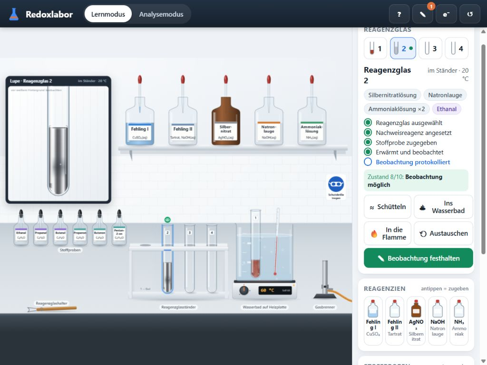
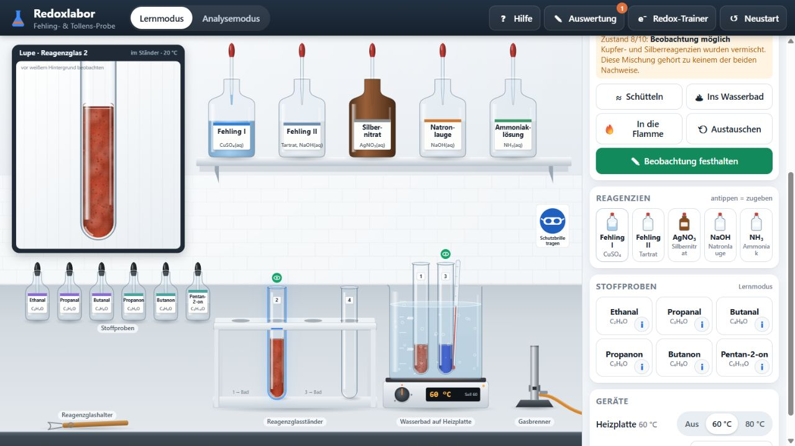

# Redoxlabor – unabhängige Prüfung vom 22.10.2026

Geprüft: `apps/redoxlabor/` im lokalen Repository `D:\Eigene Dateien\Eigene Dokumente\Playground\SiVex`, Commit `d9fe6a3f05203721453ef8e0c1fcd421aa5ea3e0`. GitHub-main zeigte denselben Commit. Der Arbeitsbaum war zu Beginn sauber. An der Anwendung wurden keine Änderungen vorgenommen; dieser Bericht und der zugehörige Claude-Prompt sind neue Dokumentation.

## Urteil und Prüfumfang

Ein gut strukturierter und anschaulicher Prototyp. Die vorgesehenen Standardversuche funktionieren; die Simulation ist aber bei nachträglichen Zugaben, Heizhistorie und Bewertung noch nicht konsistent genug für eine uneingeschränkte fachliche Freigabe. Die bisherigen Tests bestätigen vor allem die programmierten Annahmen. Beispielsweise erzwingt ein Test ausdrücklich R–COOH und ein anderer das Ausbleiben der Tollens-Reaktion bei Raumtemperatur; solche Tests belegen keine unabhängige fachliche Richtigkeit.

Selbst durchgeführt:

- Alle **45 Unit-Tests bestanden**, direkt mit `node --test tests/unit/*.test.js` unter Node 24.19.0. `npm` war in dieser Shell nicht im PATH.
- Im laufenden Browser: Fehling I/II ansetzen, schütteln, Ethanal zugeben, im Wasserbad erwärmen, positiven Niederschlag und korrekte Protokollbewertung prüfen; Tollens-Reagenz über braunes Silberoxid und tropfenweise NH₃ herstellen, Ethanal zugeben, Silberbelag beobachten; negative Fehling-Probe mit Propanon; erster Schritt des Redox-Trainers mit korrekten Antworten.
- Zusätzliche gezielte Node-Reproduktionen über die Chemie- und Labor-API für die unten beschriebenen Randfälle.
- Visuelle Kontrolle im normalen Browserfenster und bei **1024 × 768 CSS-Pixeln**. Dort betrug die Dokumentbreite ebenfalls 1024 Pixel, also kein horizontales Seitenüberlaufen.
- Fachliche Gegenprüfung mit RSC-, Hochschul- und NIST-Quellen.

Nicht neu durchgeführt: die vollständigen vorhandenen 26 automatisierten E2E-Prüfungen, SCORM-LMS-Tests, ein echtes iPad/Safari, ein echter mebis-Kurs oder ein Unterrichtstest. Die vorhandenen entsprechenden Berichte sind Vorbefunde, keine Ergebnisse dieser Prüfung.

## Reproduzierte Fehler und Bewertungsprobleme

### R1 – P1: Heizzeit ohne Probe ermöglicht einen sofort abgeschlossenen negativen Nachweis

**Fundstellen:** `js/chemistry.js:163` (Zugabe), `:286` (Heizdosis), `:316` (Beobachtbarkeit), `:554` (Bewertung).

**Reproduktion über die öffentliche Labor-API:** Fehling I und II ansetzen und schütteln; 60 Simulationssekunden im 80-°C-Bad erwärmen; in den Ständer stellen, 120 Sekunden abkühlen lassen; erst jetzt Propanon zugeben.

**Ist:** unmittelbar danach Temperatur etwa 20.00007 °C, `outcome = negative`, Phase `observable`. Es gibt keine ausreichende gemeinsame Erwärmung von Probe und Reagenz. Selbst fehlende Durchmischung verhindert die negative Endbewertung nicht.

**Ursache:** `heatF` und `heatT` wachsen bei jedem nichtleeren Inhalt, unabhängig von geeigneter Probe und vollständigem Reagenz. Zugaben entwerten die vorherige Heizdosis nicht.

**Überarbeitung:** Für einen negativen Befund die Exposition des geeigneten gemeinsamen Ansatzes zählen. Relevante Änderungen an Probe/Reagenz müssen diese Beobachtungszeit neu beginnen lassen. Eine zuvor entstandene positive Reaktion darf dabei nicht einfach gelöscht werden.

### R2 – P1: Gemeinsamer Umsatz lässt Silber verschwinden und erzeugt daraus scheinbar Cu₂O

**Fundstellen:** `js/chemistry.js:190`, `:291`, `:386`, `:417`; ergänzend `js/render.js:659`.

**Reproduktion:** Tollens-Probe mit Ethanal vollständig ausführen; zum fertigen Silberspiegel eine Portion Fehling I geben. Vorher: `progress = 1`, `mirror = 1`. Nachher: `system = foreign`, `mirror = 0`, ziegelrote Trübung mit RGB `[172,56,30]` und Alpha 0.94 – auch bei Raumtemperatur.

**Ursache:** Fehling- und Tollens-Reaktion teilen sich `progress`. Jeder fremde Ansatz mit bereits vorhandenem Umsatz läuft im optischen Modell durch die Cu₂O-Darstellung. Gleichzeitig hängt der vorhandene Silberfilm vom aktuell gültigen Tollens-Status ab.

**Folge:** Es wird ohne passende Reaktion ein neues Reduktionsprodukt dargestellt. Ein ungültig gewordenes Nachweisverfahren und physisch vorhandene Reaktionsprodukte werden verwechselt.

**Überarbeitung:** Produktmengen und Wandbelag unabhängig vom aktuellen Reagenzstatus speichern; Ag, Cu₂O, CuO und gegebenenfalls nicht umgesetzte Edukte unterscheiden. Zusätze dürfen die Auswertbarkeit ändern, aber Produkte nicht allein durch einen Statuswechsel umdeuten. Ein vollständiger Gleichgewichtslöser ist dafür nicht nötig.

**Verwandter reproduzierter Fall:** Fehling I + NaOH beim Erwärmen ergibt `cuo = 1` und schwarze Trübung. Nach Fehling-II-Zugabe springt die Analyse auf `ready`, Trübungsalpha auf 0, obwohl `cuo = 1` bleibt. Der gespeicherte Reaktionszustand wird ignoriert. Ein möglicher realer Lösungsvorgang müsste eigens modelliert oder der Ansatz als außerhalb des Modells behandelt werden.

### R3 – P2: Validierungsfehler löscht sämtliche Protokolleingaben

**Fundstellen:** `js/ui.js:495`, `:525`.

**Im Browser reproduziert:** Verfahren und Beobachtung auswählen, Notiz schreiben, andere Pflichtfelder offen lassen, „Speichern und auswerten“ anklicken.

**Ist:** Fehlermeldung erscheint; alle Auswahlen sind zurückgesetzt und die Notiz ist leer.

**Ursache:** `renderDrawer()` erzeugt das Formular erneut; `formHtml()` setzt immer leere Werte ein. Ein Entwurf wird nicht gespeichert.

**Überarbeitung:** Entwurf je Reagenzglas/Generation halten und nach Validierung wieder einsetzen. Auch Schließen und erneutes Öffnen sollten Eingaben erhalten. Feedback an fehlenden Feldern anzeigen und auf das erste fehlende Feld fokussieren.

### R4 – P2: Frühe Auswertung bleibt endgültig, obwohl der Versuch weiterreagiert

**Fundstellen:** `js/lab.js:354`, `:452`; `js/ui.js:128`.

**Reproduktion:** Korrekt angesetzte Fehling-Probe mit Ethanal sofort nach dem Einstellen ins Bad als noch unvollständig protokollieren und auswerten; danach weiter erwärmen.

**Ist:** Der aktuelle Ansatz ist später positiv, aber `phaseOf()` meldet weiterhin `evaluated`; das Protokoll enthält den alten Befund `unfinished`. Die reguläre Kennzeichnung einer neu möglichen Beobachtung wird durch `recordedId` unterdrückt.

**Einordnung:** Historische Beobachtungen sollen erhalten bleiben. Fehlerhaft ist, dass sie ohne Kennzeichnung den aktuellen, weiterlaufenden Versuch als abschließend ausgewertet erscheinen lassen.

**Überarbeitung:** Zeitpunkte/Zustandsversionen unterscheiden; frühere Beobachtung erhalten und als Zwischenstand kennzeichnen, später erneut zum Beobachten und Auswerten auffordern.

### R5 – P2: Sichtbarer positiver Nachweis wird bis 97 % Modellumsatz abgewiesen

**Fundstellen:** `js/chemistry.js:316`, `:554`.

**Reproduktion:** Fehling-Probe mit Ethanal bis `progress ≈ 0.604` erwärmen. Das Modell zeigt bereits eine kräftig orange Trübung mit Alpha etwa 0.767.

**Ist:** `outcome = unfinished`, `result = ungueltig`, `interpretation = keineAussage`. Eine positive Auswertung wird als falsch behandelt.

**Fachliche Beurteilung:** Ein charakteristisches, deutlich sichtbares Nachweisprodukt erlaubt bereits eine positive qualitative Aussage. Vollständiger Umsatz ist keine Voraussetzung. Für einen belastbaren negativen Befund ist dagegen eine ausreichende Beobachtungszeit erforderlich.

**Überarbeitung:** Sichtbarkeit eines charakteristischen positiven Signals von Reaktionsabschluss und erforderlicher Wartezeit für negative Befunde trennen. Frühe Beobachtungen dürfen nicht pauschal als beweislos gelten.

### R6 – P2: Tollens-Darstellung und allgemeine Aussage zum notwendigen Erwärmen sind zu eng

**Fundstellen:** `js/chemistry.js:117`, `:417`, `:559`, `:573`; `tests/unit/chemistry.test.js`, Test „Positive Tollens-Auswertung“.

Der ideale Verlauf mit sauberem Glas und Silberfilm ist plausibel. Die aktuelle Bewertung verlangt jedoch einen Wandbelag; graues/schwarzes Silber allein genügt nicht. Real kann auch fein verteiltes elementares Silber einen positiven Nachweis darstellen. Das ist von braunem Ag₂O in unvollständig angesetztem Reagenz zu unterscheiden. Primärquelle: [Strathclyde, Untersuchung des Tollens-Tests, Kapitel 7](https://stax.strath.ac.uk/downloads/kh04dq07h?locale=en).

Das Modell setzt unter 35 °C jede Tollens-Reaktion auf null. Die interne Dokumentation benennt dies als Vereinfachung; die Auswertung formuliert hingegen allgemein, ohne Erwärmen ließe sich noch nichts ableiten. Eine Hochschuluntersuchung beschreibt positive Befunde sofort oder nach Erwärmen: [UCL, Abschnitt 2.6.6](https://discovery.ucl.ac.uk/id/eprint/10099442/1/U643633.pdf).

**Überarbeitung:** Im Basismodell ausdrücklich „Wir betrachten hier den beschleunigten Versuch im warmen Wasserbad“ formulieren; optional langsame Raumtemperaturreaktion und unterschiedliche Formen der Silberabscheidung modellieren. Die Unterrichtsbewertung muss zum tatsächlich sichtbaren Zustand passen.

## Fachlich richtig, bewusst vereinfacht und noch zu klären

- Die sechs enthaltenen Stoffe, Strukturformeln, Summenformeln und Oxidationszahlen passen. Die vorgesehenen drei Alkanale reagieren positiv, die drei einfachen Ketone negativ. Das ist für diesen Probensatz richtig; daraus keine Regel für sämtliche Ketone oder sämtliche Aldehyde ableiten.
- Fehling I hellblau, Fehling II farblos, gemeinsam tiefblau, positives Ergebnis als Cu₂O-Niederschlag: fachlich passend. [FU Berlin, Fehling-Probe](https://www.bcp.fu-berlin.de/en/chemie/chemie/forschung/OrgChem/schalley/Teaching/OCI_Videos/Versuch10_02/index.html).
- Tollens-Herstellung über braunes Ag₂O und Auflösen mit NH₃ ist als Schulmodell gut getroffen. Die „zwei NH₃-Portionen“ sind eine abstrakte Regel und keine echte Mengenangabe. Ebenso sind die Reaktionszeiten und die relative Reihenfolge der Aldehydgeschwindigkeiten modelliert, nicht als Messdaten belegt.
- **R–COOH ist kein Atom- oder Ladungsbilanzfehler:** Die hinterlegten Gleichungen sind formal ausgeglichen. Die App dokumentiert die protonierte Carbonsäure ausdrücklich als Schulkonvention. Im alkalischen Ansatz ist jedoch das Carboxylat angemessen; der Hinweis ist bislang unter einem zugeklappten Detail verborgen. Empfehlung: Hinweis direkt an die Gleichung stellen und eine fachlich genaue Ansicht ergänzen. [RSC, Silberspiegelversuch](https://edu.rsc.org/experiments/the-silver-mirror-test-with-tollens-reagent/822.article).
- Fachlich genaue Oxidation: `R–CHO + 3 OH⁻ → R–COO⁻ + 2 H₂O + 2 e⁻`. Entsprechend Fehling gesamt: `R–CHO + 2 Cu²⁺ + 5 OH⁻ → R–COO⁻ + Cu₂O + 3 H₂O`; Tollens gesamt: `R–CHO + 2 [Ag(NH₃)₂]⁺ + 3 OH⁻ → R–COO⁻ + 2 Ag + 4 NH₃ + 2 H₂O`. Die Cu-Komplexierung bleibt dabei weiterhin vereinfacht.
- Die Proben sollten explizit als geeignete verdünnte Lösungen bezeichnet werden. „Ethanal“ in einer offenen Pipettenflasche kann sonst als Reinstoff verstanden werden. Reines Ethanal siedet bereits um 21 °C; die angenommene Form der Probe ist daher für Realismus relevant. Das bedeutet nicht, dass ein wässriger Reaktionsansatz bei 21 °C siedet. [NIST, Acetaldehyd](https://webbook.nist.gov/cgi/cbook.cgi?ID=C75070&Mask=4&Units=CAL).
- Tollens-Frische, nicht aufbewahren, geeignete Handhabung und Entsorgung sollten schon beim regulären Ablauf als kurzer Lernhinweis vorkommen. Die vorhandene spezifische Warnung erscheint erst nach einem Flammenunfall (`js/ui.js:376`). Keine pauschale Übernahme von Entsorgungsanweisungen aus ausländischen Quellen; regionale Schulregeln beachten. Der virtuelle Austausch eines Glases kann den Abschluss/Abfallweg didaktisch sichtbar machen.

## Grafik und Abläufe

**Stärken:** konsistente, ruhige Gestaltung; gut erkennbare Geräte; plausible Glaskanten und Menisken; unterscheidbare klare Lösungen und Niederschläge; überzeugender metallischer Silberbelag; Lupe unterstützt die Beobachtung. Antippen als Alternative zu Drag-and-drop und die dreistufigen kontextabhängigen Hilfen sind sinnvoll. Experiment, Beobachtung, Deutung und Gleichungstrainer sind gut aufeinander bezogen.

**Verbesserungen nach Nutzen:**

1. **Neutraler Beobachtungshintergrund:** Trotz Text „vor weißem Hintergrund beobachten“ wird in der Lupe ein blau getöntes Wasserbad hinter das Reagenzglas gezeichnet (`js/render.js:1415`). Das beeinflusst besonders die Wahrnehmung farbloser oder schwach gefärbter Proben. Badkontext im Labortisch lassen, Lupe neutral gestalten oder einen neutralen Vergleichsmodus anbieten.
2. **Bläschen zurücknehmen:** In Reagenzglas und Wasserbad steigen ab relativ niedrigen Temperaturen dauerhaft Blasen auf (`js/render.js:973`, `:1424`). Bei 60/80 °C siedet Wasser bei normalem Druck nicht; die Nachweisgleichungen erzeugen kein Gas. Anfangs können gelöste Gase entweichen. Darstellung zeitlich begrenzen oder als Entgasen erläutern, nicht wie stetiges Kochen zeigen.
3. **Farbverlauf als mögliches Erscheinungsbild zeigen:** Blau → grünlich → orange/rot ist anschaulich, aber keine unveränderliche Abfolge für alle Konzentrationen, Mischungen und Partikelgrößen. Der Verlauf ist als Modell brauchbar; eine wissenschaftliche Farb-/Kinetiksimulation ist er nicht.
4. **Sedimentation verbessern:** Aktuell setzt sich Cu₂O erst unter 38 °C ab (`js/render.js:704`). Das ist eine sichtbare Modellgrenze; reales Absetzen hängt auch von Partikelgröße und Konvektion ab. Langsames Absetzen in ruhigem warmem Ansatz und erneutes Aufschlämmen wären plausibler.
5. **Beschriftungen lesbarer:** Im Seitenpanel entstehen bei schmalen Reagenzknöpfen unschöne Wortabbrüche, z. B. „Silbernitra / t“, teils auch Fehling I/II (`css/app.css:144`). Größere Kacheln oder zwei Zeilen mit sinnvoller Trennung, Bezeichnung beim Anwählen vergrößern.
6. **Ablauf klarer führen:** Nach Auswahl eines Reagenzglases vergrößert sich die obere Bedienkarte; die Geräte/Proben sind dann oft nur durch Scrollen sichtbar. Eine feste kompakte Aktionsleiste, angepinnte Temperatursteuerung oder aufklappbare Abschnitte würden die Wechsel verkürzen.
7. **Zugänglichkeit nachprüfen:** Das Canvas stellt Ergebnisse nicht als gleichwertigen strukturierten Text bereit; automatische Panel-Neuerstellung kann Tastaturfokus verlieren. Das innere Strukturinfo-Element hat eine Button-Rolle, aber keinen eigenen Enter-/Leertasten-Handler. Fokusführung, Tastaturbedienung und Screenreader-Ausgabe sollten gezielt getestet werden; hier erfolgte kein vollständiges Accessibility-Audit.

Die Feuerwarnung ist grundsätzlich als Lernfall verständlich, aber nach festen 2,6 Sekunden unvermeidlicher Siedeverzug ist ein geskriptetes Szenario, kein allgemeines physikalisches Gesetz. Als solches kennzeichnen. Im Standardablauf den Brenner weniger prominent anbieten als das geeignete Wasserbad.

## Weitere Verbesserung der Auswertung

`overview()` (`js/lab.js:477`) überschreibt ein vorhandenes gültiges Ergebnis auch durch den späteren ungültigen Versuch derselben Probe. Reproduziert: Protokollhistorie `[positive, invalid]`, danach `hasEvidence = false`. Die Oberfläche erklärt zwar, sie zeige das jeweils letzte Protokoll; insofern ist dies eine Designentscheidung und kein versteckter Programmabsturz. Für begründetes Auswerten sollten jedoch letzter Versuch und letzte gültige Evidenz getrennt sichtbar sein. Ein gescheiterter Wiederholungsversuch löscht die frühere Beobachtung nicht.

## Weiterentwicklung in sinnvoller Reihenfolge

1. Zuerst R1–R5 absichern; für jede Reproduktion einen Regressionstest hinzufügen. Testen, ob eine geänderte Reihenfolge, zusätzliche Portionen und Zwischenprotokolle sinnvoll behandelt werden. Fachliche Freigabe nicht allein aus Pixeltests ableiten.
2. Kontrollversuche und Hypothesen: Blindprobe und bekannte positive/negative Vergleichsprobe nebeneinander, Vorhersage vor dem Versuch, anschließend Begründung der Beobachtung. Eine Versuchshistorie mit Zeit/Temperatur und selbst gesetzten Beobachtungsmarken verbessert das Protokoll.
3. Teilchenansicht: Cu(II)-Komplex → Cu₂O bzw. Ag(I)-Komplex → Ag, Oxidation des Carbonyl-C, und Elektronenbilanz mit Makrobeobachtung verbinden. Elektronenübertragung schematisch darstellen, keine frei durch die Lösung fliegenden Elektronen suggerieren.
4. Expertenmodus: Glucose, Fructose, Saccharose; Fructose über alkalische Umlagerung erklären, nicht alle Ketone pauschal positiv setzen. Später Benzaldehyd als Beispiel unterschiedlicher Aussagekraft der Nachweise, mit eigenständig geprüftem Modell.
5. Variablenversuche: Temperatur, Probenkonzentration, Mischen und Glasreinheit; nachvollziehbare Einflussgrößen statt unbegründeter Stoffgeschwindigkeiten. Modellcharakter sichtbar halten.
6. Export eines verständlichen Schülerprotokolls als Druckansicht/PDF oder lokale Datei. Bestehendes datensparsames SCORM-Konzept erhalten; Noten-/Fortschrittsübertragung wäre eine gesonderte Produktentscheidung.
7. Danach echte iPad-/Safari- und mebis-Tests sowie ein kurzer Unterrichtstest mit Lernenden der Zielgruppe.

## Abnahmekriterien für die nächste Fassung

- Eine erst nach Abkühlen zugegebene Probe besitzt keine mitgebrachte gültige Heizdosis.
- Ein bestehender Silberbelag bleibt als Silber erhalten; ein Wechsel auf „fremder Ansatz“ erzeugt kein Cu₂O aus vorherigem Tollens-Umsatz.
- Phasenprodukte werden bei Folgezugaben explizit berücksichtigt; keine rein zustandsbedingten Sprünge von schwarz zu klar.
- Formularentwürfe bleiben bei Validierungsfehlern erhalten.
- Frühere Protokolle erscheinen als zeitgebundene Beobachtungen; ein weiterlaufender Versuch kann erneut beobachtet und ausgewertet werden.
- Deutlich sichtbare positive Nachweisprodukte erlauben eine passende positive Schlussfolgerung; negative Befunde setzen geeignete Bedingungen und ausreichende Beobachtungszeit voraus.
- Fachliche Vereinfachungen sind unmittelbar an der jeweiligen Anzeige verständlich erklärt.
- Echte Geräte-/LMS-Tests und nicht durchgeführte Prüfungen werden im neuen Bericht klar getrennt.

## Eigene Bildnachweise dieser Prüfung

Korrekter Silberbelag im Ständer, Tablet-Viewport 1024 × 768:

Derselbe Ansatz nach zusätzlicher Fehling-I-Zugabe, jetzt bei Raumtemperatur: Der Silberbelag verschwindet und die Anzeige springt auf roten Niederschlag. Dies ist der unter R2 beschriebene Modellfehler.

