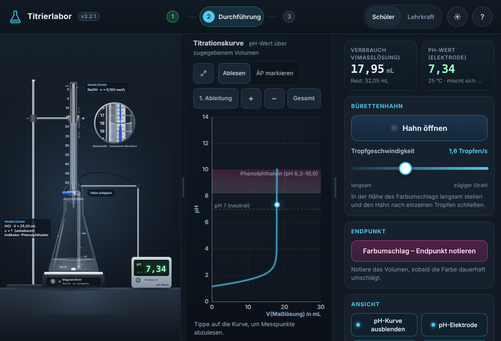
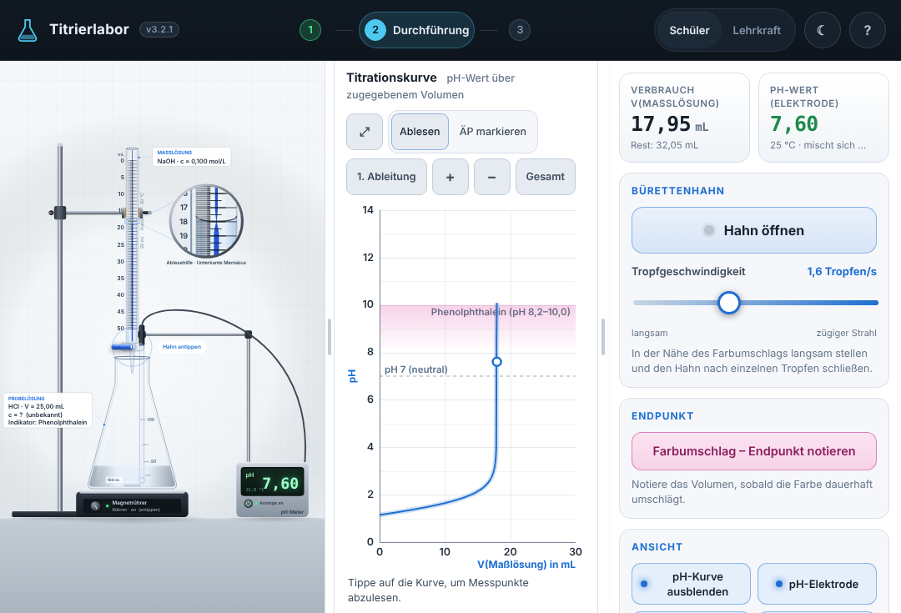

# TitraLab 3 – Virtuelle Säure-Base-Titration

Virtuelle Titration von Salzsäure, Natronlauge, Essigsäure und Ammoniaklösung mit Indikator (Phenolphthalein, Bromthymolblau, Methylorange), pH-Elektrode und Titrationskurve. Der pH-Wert wird für jedes zugegebene Volumen aus der Ladungsbilanz berechnet; die Auswertung prüft die eigene Konzentrationsberechnung und benennt typische Fehler (Einheiten, vertauschte Volumina, Über- oder Untertitration). Jgst. 10–13.

| dunkel (Standard) | hell |
| --- | --- |
|  |  |

**Version 3.2.1 – ready.** Von der Lehrkraft auf dem iPad geprüft und am 09.11.2026 für den Unterricht freigegeben (Einsatz ab 10.11.2026; [Änderungen](CHANGELOG.md), [Testbericht](docs/TESTBERICHT.md)).

## Download

**[⬇ SCORM 1.2 (titration-3.2.1-scorm12.zip)](https://github.com/sscheidl/sivex/raw/main/apps/titration/release/titration-3.2.1-scorm12.zip)** · [⬇ Web-ZIP (titration-3.2.1-web.zip)](https://github.com/sscheidl/sivex/raw/main/apps/titration/release/titration-3.2.1-web.zip) · Prüfsummen: [`release/SHA256SUMS.txt`](release/SHA256SUMS.txt)

In mebis: Kurs → „Aktivität oder Material anlegen“ → „Lernpaket (SCORM)“ → ZIP hochladen → Darstellung „Neues Fenster“. Webserver: Web-ZIP entpacken und den Ordner `titration/` per HTTPS bereitstellen; die App läuft nach dem ersten Laden auch offline (Service Worker).

Das Release 3.0 (`SiVex-Titration-Claude-v3-*.zip`) liegt in der Git-Historie (Stand vor dem Branch `feature/titration-3.1`).

## Bedienung

1. **Vorbereitung:** Probelösung, Volumen (5–50 mL), Maßlösung (0,01–0,5 mol/L), Indikator, pH-Elektrode und Rührer wählen. Standard: Die Konzentration der Probe ist unbekannt (zufällig, Äquivalenzpunkt zwischen 12 und 42 mL).
2. **Durchführung:** Hahn antippen oder „Hahn öffnen“, Tropfgeschwindigkeit regeln, beim Farbumschlag „Endpunkt notieren“. Farbe und Elektrode folgen jedem Tropfen mit wenigen Sekunden Verzögerung (Durchmischung; ohne Rührer länger) – am Umschlag erscheint kurz die Mischfarbe des Indikators, langsames Tropfen gibt Zeit und Genauigkeit. Optional **pH-Kurve anzeigen** – sie steht rechts neben der Apparatur (im Hochformat darunter), die Trennlinie dazwischen ist verschiebbar, ⤢ zeigt die Kurve allein in voller Größe.
3. **Auswertung:** Endpunkt oder in der Kurve markierten Äquivalenzpunkt übernehmen, c(Probe) berechnen, eingeben, prüfen lassen. Lehrkraftmodus zeigt verdeckte Werte, theoretische Kurve und Indikatoreignung.

☀/☾ in der Kopfzeile schaltet zwischen dunklem Schema (wie bisher) und hellem Schema (wie die übrigen SiVex-Apps) um; Wahl, Breite der Steuerleiste und der Kurve werden lokal im Browser gemerkt. Es werden keine Daten übertragen.

## Aufbau

```
index.html          Oberfläche (eine Seite, drei Phasen)
css/styles.css      Stil mit CSS-Variablen für beide Farbschemata
js/model/           Chemie (Ladungsbilanz), Indikatoren, Konfiguration, Auswertung – ohne DOM, in Node testbar
js/experiment/      Zeitverhalten: Hahn, Tropfen, Fallzeit, Endpunkt, Durchmischung (sichtbarer pH)
js/view/            Laborgrafik (Canvas), Diagramm, Geometrie, Farbpaletten (theme.js)
js/ui/app.js        Ablaufsteuerung, Bedienfeld, Trennlinien, Farbschema
sw.js               Offline-Cache (nur eigenes Verzeichnis)
scripts/            serve (Entwicklung), build (Kopie + Prüfung), package (ZIPs + SHA-256)
tests/unit          node --test
tests/e2e           Playwright-Abnahme mit Screenshots
```

Modell: 25 °C, ideal verdünnt, carbonatfrei, K_W = 1,0·10⁻¹⁴, pKₛ(CH₃COOH) = 4,75, pKₛ(NH₄⁺) = 9,25; starke Säure/Base geschlossen (quadratische Gleichung), schwache Komponente per Bisektion in lg c(H₃O⁺). Indikatorfarbe und Elektrodenanzeige folgen dem Gleichgewichts-pH mit Zeitkonstante 3 s (Rührer an) bzw. 8 s (aus); die Messkurve enthält je Tropfen den eingeschwungenen Wert und bleibt damit glatt. Die Laborgrafik (Glas, Meniskus, Tropfen, verschiebbare Trennlinie) ist Referenz für die übrigen Apps, siehe [`docs/QUALITY.md`](../../docs/QUALITY.md).

## Entwicklung

```
npm test            Unit-Tests
npm run build       dist/titration/ mit Prüfung (keine externen Ressourcen, Service Worker vollständig)
npm run package     release/titration-<version>-{web,scorm12}.zip + SHA256SUMS.txt (reproduzierbar)
npm run test:e2e    Browserabnahme gegen dist/ (benötigt playwright, z. B. npm install)
npm start           Entwicklungsserver auf Port 8080
```

Versionsnummer an drei Stellen gleich halten: `package.json`, `sivex.json`, Kopfzeile in `index.html` (`npm run package` prüft das).
