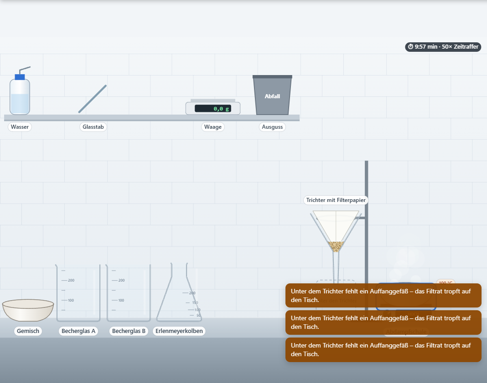
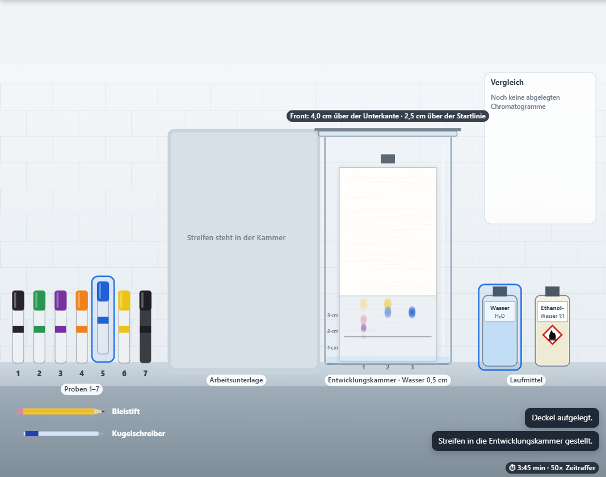
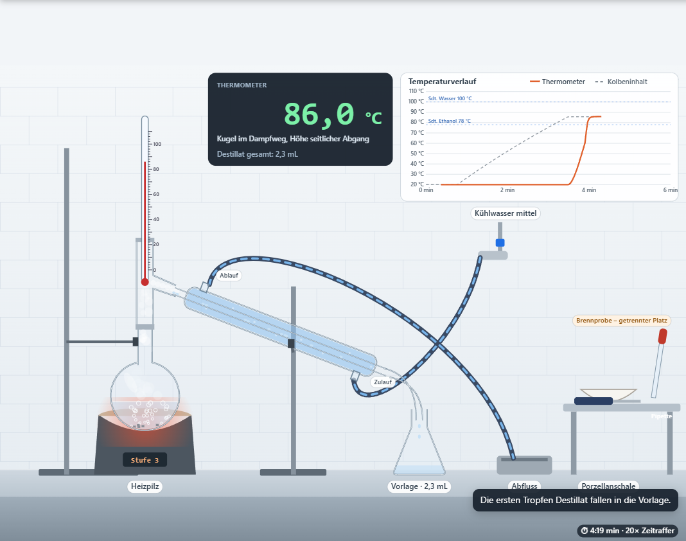

# Trennlabor – Stofftrennung im virtuellen Labor

**Status: prototype** (technisch vollständig und automatisiert geprüft – siehe [Testbericht](docs/TESTBERICHT.md); Praxiserprobung auf Schul-Tablets, in mebis und im Unterricht steht aus)

Virtuelles, frei bedienbares Chemielabor für die Jahrgangsstufen **NTG 8 / SG 9**. Drei Labore mit gleicher Grundnavigation und Hilfesystematik:

| Labor | Standardversuche |
| --- | --- |
| **A – Klassische Trennverfahren** | K-01 Sand und Wasser · K-02 Sand und Kochsalz · K-03 Eisen, Sand und Kochsalz · K-04 Öl und Wasser · K-05 Hibiskustee (Extraktion) |
| **B – Papierchromatographie** | sieben Proben, zwei Laufmittel; C-1 Welche Stifte enthalten mehrere Farbstoffe? · C-2 Gemeinsamer Farbstoff in Grün und Violett · C-3 Wasserfester Stift in zwei Laufmitteln |
| **C – Destillation** | D-1 Ethanol-Wasser-Gemisch destillieren, Dampftemperatur verfolgen, Brennprobe |


| Klassisch: Eindampfen (K-02) | Chromatographie: Entwicklung (C-1) | Destillation (D-1) |
| --- | --- | --- |
|  |  |  |

## Download

**[⬇ SCORM-1.2-Paket für mebis (trennlabor-1.0.0-scorm12.zip)](https://github.com/sscheidl/sivex/raw/main/apps/trennlabor/release/trennlabor-1.0.0-scorm12.zip)** · [⬇ Web-Version (trennlabor-1.0.0-web.zip)](https://github.com/sscheidl/sivex/raw/main/apps/trennlabor/release/trennlabor-1.0.0-web.zip) · [Prüfsummen](release/SHA256SUMS.txt)

In mebis: Kurs → „Aktivität oder Material anlegen“ → „Lernpaket (SCORM)“ → ZIP hochladen → Darstellung „Neues Fenster“ (siehe [`docs/MEBIS.md`](../../docs/MEBIS.md)).

## Starten

Die Anwendung ist vollständig statisch (HTML, CSS, JavaScript), braucht weder Server-Logik noch Internet und lädt keine externen Ressourcen.

| Weg | Vorgehen |
| --- | --- |
| Direkt | `index.html` im Browser öffnen (funktioniert auch per `file://`). |
| Lokaler Testserver | `npm start` → <http://localhost:8080/> (Node.js ≥ 18, keine Laufzeitabhängigkeiten) |
| Webserver | `npm run build` und den Ordner `dist/trennlabor/` per HTTPS bereitstellen; alle Pfade sind relativ. Oder `release/trennlabor-1.0.0-web.zip` entpacken. |
| mebis/Moodle | `release/trennlabor-1.0.0-scorm12.zip` als SCORM-1.2-Lernpaket hochladen. |

Direktaufruf eines Labors: `index.html?lab=classic`, `?lab=chroma`, `?lab=distill`.

## Bedienkonzept

Freies Labor statt Klick-Anleitung: Problemstellung → eigene Geräte-, Stoff-, Mengen- und Reihenfolgewahl → sichtbare Folgen (auch Fehlversuche) → **Ergebnis prüfen** am tatsächlichen Zustand → Beobachtungsfragen, Messwerte und Lückentexte zum eigenen Versuch → Theorie Schritt für Schritt → **Muster-Hefteintrag** zum Abschreiben. Hilfe in genau drei Stufen (keine / kleine / konkrete Hilfe), bei wiederholtem Scheitern angeboten. Alle Handlungen sind per Antippen/Klicken im Bedienfeld oder auf der Laborbühne möglich; Ziehen ist eine Zusatzoption. Details: [docs/BEDIENUNG.md](docs/BEDIENUNG.md).

## Aufbau des Quellcodes

| Datei | Aufgabe |
| --- | --- |
| `js/core.js` | Mathematik, feste Zeitschritte (Zeitraffer ohne Ergebnisänderung), Prüfung eingetippter Fachbegriffe |
| `js/classic.js` | Fachmodell klassische Trennverfahren (ohne DOM): Gefäße, Mengenbilanz, Sedimentation, Filtration, Lösen, Eindampfen, Magnet, Scheidetrichter, Extraktion |
| `js/chroma.js` | Fachmodell Papierchromatographie (ohne DOM): Modelldatenset, Laufmittelfront, Banden, Güte, Rf |
| `js/distill.js` | Fachmodell Destillation (ohne DOM): Aufbau, Energie-/Stoffbilanz, Siede-/Dampfdaten, Kühler, Sicherheitslogik, Brennprobe |
| `js/tasks.js` | Aufgaben: Bewertung am Zustand, zustandsabhängige Hilfe, Fragen/Lückentexte, Theorie, Hefteinträge |
| `js/gfx.js`, `js/render-*.js` | Canvas-2D-Darstellung, liest nur den Modellzustand |
| `js/ui.js`, `js/app.js` | Bedienoberfläche, Persistenz im `sessionStorage`, Animationsschleife |
| `js/scorm.js` | minimaler SCORM-1.2-Adapter (nur LMSInitialize/LMSFinish) |

Fachliche Modellannahmen, Stoffdaten und Grenzen: [docs/CHEMIE.md](docs/CHEMIE.md).

## Tests

Voraussetzung: Node.js ≥ 18; für Browser-Tests Playwright (`npm install`) und Chromium oder Edge (`PW_CHANNEL=msedge`).

```bash
npm test                 # Unit- und Regressionstests der Fachmodelle und Aufgaben
npm run package          # Build prüfen, Web- und SCORM-ZIP erzeugen, Prüfsummen
npm run test:e2e         # Browser-End-to-End-Tests der echten Oberfläche (gegen dist/)
npm run test:scorm       # gepacktes SCORM-ZIP im simulierten LMS (iframe und neues Fenster)
```

Ergebnisse: `tests/e2e/results.json`, `tests/e2e/scorm-results.json`, Screenshots in `docs/screenshots/`. Bericht: [docs/TESTBERICHT.md](docs/TESTBERICHT.md).

## Grenzen

- Didaktisch vereinfachte Modelle (verkürzte Zeitkonstanten, Modellfarbstoffe, Azeotrop Ethanol/Wasser vernachlässigt) – siehe [CHEMIE.md](docs/CHEMIE.md).
- Zwischenstände bleiben nur im geöffneten Browserfenster (`sessionStorage`); keine dauerhafte LMS-Speicherung.
- Geprüft in Chromium/Edge mit Desktop- und Tablet-Viewports inklusive Touch-Emulation; echte iPads (Safari), ein realer mebis-Kurs und der Unterrichtseinsatz sind nachgelagerte Praxistests der Lehrkraft.
