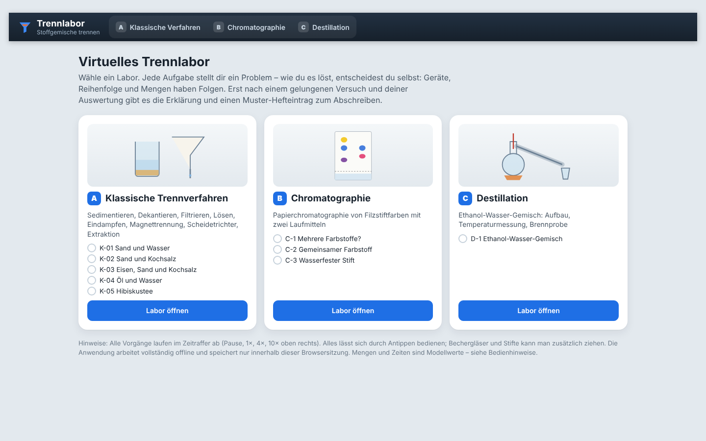
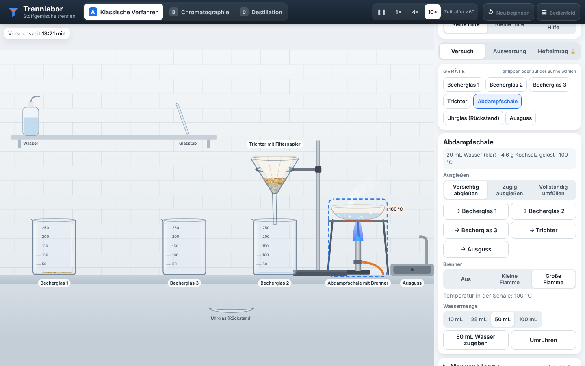
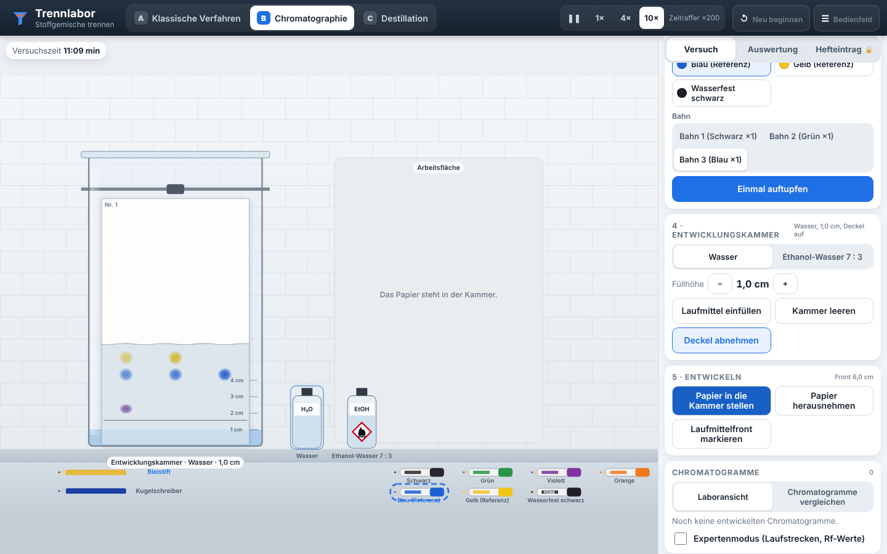
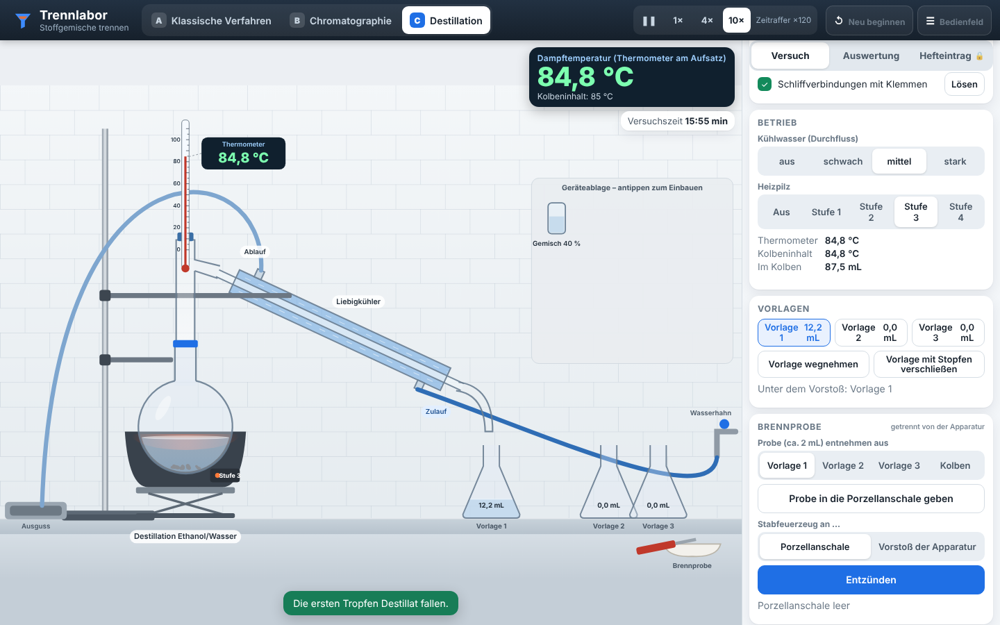

# Trennlabor – Stoffgemische trennen

**Status: prototype** – technisch vollständig umgesetzt und automatisiert geprüft (Unit-, Browser-, SCORM- und Pakettests, siehe [Testbericht](docs/TESTBERICHT.md)). Ausstehend sind die praktischen Nachtests durch die Lehrkraft (Schul-iPads, realer mebis-Kurs, Unterricht).

Virtuelles, freies Trennlabor für **NTG 8 / SG 9** am bayerischen Gymnasium. Die Lernenden bekommen eine Problemstellung und entscheiden selbst über Geräte, Reihenfolge, Mengen und Bedienung – Fehlgriffe haben sichtbare, fachlich plausible Folgen. Erst nach einem gelungenen Versuch und der eigenen Auswertung gibt es Erklärung und Muster-Hefteintrag.



## Download

**[⬇ SCORM-1.2-Paket für mebis (trennlabor-1.0.0-scorm12.zip)](https://github.com/sscheidl/sivex/raw/main/apps/trennlabor/release/trennlabor-1.0.0-scorm12.zip)** · [⬇ Web-Version (trennlabor-1.0.0-web.zip)](https://github.com/sscheidl/sivex/raw/main/apps/trennlabor/release/trennlabor-1.0.0-web.zip) · [Prüfsummen](release/SHA256SUMS.txt)

In mebis: Kurs → „Aktivität oder Material anlegen“ → „Lernpaket (SCORM)“ → ZIP hochladen → Darstellung **„Neues Fenster“** (siehe [`docs/MEBIS.md`](../../docs/MEBIS.md)).

## Die drei Labore

| | Labor | Aufgaben |
| --- | --- | --- |
| **A** | Klassische Trennverfahren | **K-01** Sand und Wasser · **K-02** Sand und Kochsalz (beide Stoffe zurückgewinnen) · **K-03** Eisen, Sand und Kochsalz · **K-04** Öl und Wasser (Scheidetrichter) · **K-05** Hibiskustee durch Extraktion (kalt/heiß) |
| **B** | Papierchromatographie | **C-1** Welche Stifte enthalten mehrere Farbstoffe? · **C-2** Gemeinsamer Farbstoff in Grün und Violett · **C-3** Wasserfester Stift und Laufmittel · **C-4** Rf-Werte (nur im Expertenmodus) |
| **C** | Destillation | **D-1** Ethanol-Wasser-Gemisch (40 %): Aufbau, Temperaturmessung am Dampfweg, Destillat, Brennprobe |

| K-02: Eindampfen | Chromatographie | Destillation |
| --- | --- | --- |
|  |  |  |

Pflichtverfahren, die tatsächlich interaktiv vorkommen: Sedimentieren, Dekantieren, Filtrieren (gefaltetes/ungefaltetes Filterpapier, Teesieb), Lösen und Extrahieren, Eindampfen, Magnettrennung, Scheiden nicht mischbarer Flüssigkeiten, Papierchromatographie, Destillation.

## Bedienkonzept

- **Freies Labor:** Jede Handlung wird vom Modell ausgeführt, nicht von einem Ablaufskript. Mehrere fachlich sinnvolle Wege führen zum Ziel (z. B. Dekantieren statt Filtrieren in K-01/K-02, Magnet vor oder nach dem Filtrieren in K-03, Öl unten ablassen oder oben ausgießen in K-04).
- **Tippen statt Ziehen:** Alles ist über das Bedienfeld und durch Antippen der Geräte auf der Bühne erreichbar (Werkzeug antippen, dann Ziel antippen). Bechergläser und Stifte lassen sich zusätzlich ziehen. Alle Schaltflächen sind per Tastatur bedienbar.
- **Zeit:** Pause, 1×, 4×, 10× (zusätzlich zum festen Zeitraffer je Labor: A ×6, B ×20, C ×12). Die Simulation rechnet immer in festen Zeitschritten – der Zeitraffer ändert nur die Geschwindigkeit, nicht das Ergebnis.
- **Hilfe in genau drei Stufen:** keine – kleine (Denkanstoß) – konkrete (nächste sinnvolle Korrektur). Sie richtet sich nach dem aktuellen Versuchszustand; nach wiederholten Fehlern wird sie angeboten, nie ungefragt eingeblendet. Bei konkreter Hilfe erscheint im Lückentext eine Wortauswahl.
- **Auswertung:** öffnet sich, sobald der Versuch sein Ziel erreicht hat. Beobachtungsfragen und Messwerte beziehen sich auf den eigenen Versuch (Versuchsstand zum Zeitpunkt des Erfolgs), Lückentexte werden mit eigenen Begriffen gefüllt (Groß-/Kleinschreibung, Umlaute, kleine Tippfehler und Synonyme werden toleriert, fachlich falsche Begriffe wie „Absorption“ nicht). Keine KI, keine Freitextbewertung.
- **Hefteintrag:** erst nach richtig ausgewertetem Versuch – schrittweise Erklärung, dann ein Muster-Hefteintrag (Versuch, Beobachtung, Erklärung, Merksatz) zum Abschreiben.
- **Sicherheitsstopps** (Destillation): geschlossene Apparatur erhitzen, an der Apparatur zünden, offene Apparatur, Siedeverzug bei starker Heizung, austretender Dampf, Kolben fast leer, Probe aus dem heißen Kolben. Die Heizung wird virtuell abgeschaltet; nach der Korrektur geht es weiter.
- **Neu beginnen:** nur den aktuellen Versuch neu aufbauen (Abschlüsse bleiben) oder alles zurücksetzen.

Kurzanleitung für Lehrkräfte und Lernende: [docs/BEDIENUNG.md](docs/BEDIENUNG.md). Fachliche Modelle und Quellen: [docs/CHEMIE.md](docs/CHEMIE.md).

## Starten

Die Anwendung ist vollständig statisch (HTML, CSS, JavaScript) und braucht weder Server noch Internet.

| Weg | Vorgehen |
| --- | --- |
| Direkt | `index.html` im Browser öffnen (funktioniert auch per `file://`). |
| Lokaler Testserver | `npm start` → <http://localhost:8080/> (Node.js ≥ 18) |
| Webserver | `npm run build` und den Ordner `dist/trennlabor/` per HTTPS bereitstellen – oder das Web-ZIP entpacken. Alle Pfade sind relativ. |

URL-Parameter `?neu` beginnt eine frische Sitzung (sonst wird der Stand dieser Browsersitzung wiederhergestellt).

## Aufbau

```text
index.html                  Einstieg
css/app.css                 Gestaltung, responsives Layout
js/util.js                  Hilfsfunktionen, feste Zeitschritte (stepper)
js/answers.js               Prüfung von Lücken (Normalisierung, Synonyme, Sperrliste) und Zahlen
js/model/classic.js         Modell klassische Trennverfahren (Gefäße, Stoffmengen, Prozesse) – ohne DOM
js/model/chroma.js          Modell Papierchromatographie + Datensatz der 7 Proben und 2 Laufmittel – ohne DOM
js/model/distill.js         Modell Destillation Ethanol/Wasser + Sicherheitsregeln – ohne DOM
js/tasks/*.js               Aufgaben: Erfolgskriterien, Beobachtungen, Lückentexte, Theorie, Hefteintrag, Hilfe
js/session.js               Sitzung: Labore, Zeitraffer, Hilfe, Auswertung, Schnappschuss, Speicher – ohne DOM
js/render/*.js              Canvas-2D-Darstellung je Labor (zeichnet nur aus dem Modellzustand)
js/ui.js                    Bedienfeld, Eingabe (Tippen/Ziehen/Tastatur), HUD, Dialoge
js/app.js                   Start und Animationsschleife
js/scorm.js                 SCORM-1.2-Adapter (nur LMSInitialize/LMSFinish)
scripts/                    Build, Paketierung (Web-ZIP, SCORM-ZIP, Prüfsummen), Testserver
tests/unit/                 Node-Tests (Modelle, Fehlerfälle, Zeitverhalten, Aufgaben, Sitzung, Regressionen)
tests/e2e/run.mjs           Browser-Tests der wirklichen Oberfläche (Playwright, Screenshots)
tests/e2e/scorm.mjs         Prüfung des fertigen SCORM-ZIPs im simulierten LMS
tests/e2e/webzip.mjs        Prüfung des fertigen Web-ZIPs (entpackt, Server und file://)
docs/                       CHEMIE.md, BEDIENUNG.md, TESTBERICHT.md, Screenshots
release/                    Web-ZIP, SCORM-1.2-ZIP, SHA256SUMS.txt
```

Modelle und Sitzung laufen ohne DOM auch in Node; die Renderer lesen ausschließlich den Modellzustand. Stoffe werden nur verschoben, nie erzeugt oder vernichtet – Verluste (Ausguss, Tisch, verdampft, verspritzt, ausgetretener Dampf, verbrannt) sind eigene Bilanzposten. Die Mengenbilanz ist im Bedienfeld einsehbar.

## Tests

```bash
npm test             # Unit-Tests (Node, ohne Abhängigkeiten)
npm run build        # statischer Build + Prüfung auf externe Ressourcen, absolute Pfade, Netzwerkzugriffe
npm install          # einmalig für die Browser-Tests (Playwright 1.56.1)
npm run test:e2e     # Browser-Szenarien, schreibt Screenshots nach docs/screenshots/
npm run package      # Release-ZIPs (Web + SCORM 1.2) und Prüfsummen nach release/
npm run test:scorm   # fertiges SCORM-ZIP im simulierten LMS (eingebettet und neues Fenster)
npm run test:webzip  # fertiges Web-ZIP: entpacken, Rauchtest der Browser-Szenarien, file://
npm run test:all     # alles nacheinander
```

Chromium wird von Playwright mitgebracht (`npx playwright install chromium`, falls nicht vorhanden) oder per `PW_CHANNEL=msedge`/`chrome` ein installierter Browser verwendet. Ergebnisse: `tests/e2e/*.json`, Bericht: [docs/TESTBERICHT.md](docs/TESTBERICHT.md).

## Datenschutz und Offline-Betrieb

Keine Anmeldung, keine Server, keine externen Dienste, keine Analyse, keine CDN. Der Bedienungszustand und Antwortentwürfe werden nur im `sessionStorage` des eigenen Browsers abgelegt (gegen versehentliches Neuladen) und beim Schließen des Tabs verworfen. Das SCORM-Paket meldet sich beim LMS nur an und ab; es überträgt keine Noten, Fortschritte oder personenbezogenen Daten.

## Grenzen

- Zeitraffer und Modellmengen (Gramm, Milliliter, „mg Farbstoffe“) sind didaktische Modellwerte, keine Mess- oder Herstellungsanleitung.
- Chromatographie: definierte virtuelle Modellproben, keine Aussage über reale Stiftmarken.
- Destillation: einfaches Gleichgewichtsmodell (Rayleigh), Azeotrop vernachlässigt; die Brennprobe ist ein Schwellenmodell.
- 2D-Canvas-Darstellung, keine Strömungs- oder Lichtsimulation.
- Echte iPads (Safari) und ein realer mebis-Kurs wurden noch nicht getestet (Lehrkraft-Nachtest, siehe Testbericht).

Einzelheiten: [docs/CHEMIE.md](docs/CHEMIE.md), Abschnitt „Grenzen“.
